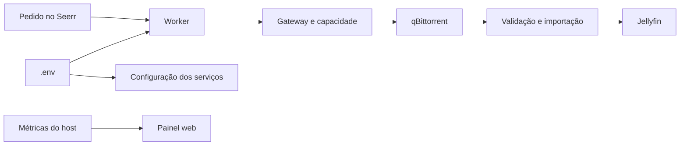

# HomeServer

HomeServer reúne Jellyfin, Seerr, Sonarr, Radarr, Prowlarr, Bazarr e qBittorrent
para organizar filmes e séries em um servidor pessoal Ubuntu. Um controlador
coordena downloads, espaço disponível, legendas, importação e exclusões
solicitadas pelo Jellyfin. O painel web mostra o estado do servidor e abre os
painéis nativos dos serviços.

A instalação usa Docker Compose. Preferências e credenciais ficam no `.env`;
caminhos, portas e redes internas têm defaults no código e no Compose. CPU é
o padrão, com [Intel UHD opcional](docs/runbooks/jellyfin-hardware.md).
CYD, MQTT exclusivo, CI/CD, releases próprias e backup do serviço foram retirados.

Na migração para Proxmox, o consumidor Jellyfin tem um
[Compose independente](compose.playback.yaml) e um
[runbook de restauração e playback NFS RO](docs/runbooks/playback-nfs.md).
Esse caminho preserva catálogo e usuários, mantém scans suspensos durante a
consolidação e usa a infraestrutura do
[homelab-platform](https://github.com/reisguilherme/homelab-platform/tree/refactor).
As instruções do monólito abaixo não devem ser usadas para iniciar as novas VMs.
O transcode usa um disco SSD virtual dedicado de 32 GiB, mantendo mídia RO e
limite de 3 GiB de RAM no container. Um transcode curto por CPU e login/logout
das 18 contas após redefinição de senha passaram; as credenciais ficam somente
no Windows privado. A lease obrigatória foi testada para expiração e HOLD,
preservando parada manual; reboot com SSD e guard passou, recusando a lease do boot anterior. A readmissão exige
prova nova e ação explícita; reboot do Proxmox pede auditoria do estado, sem
promessa de retorno integral desassistido. GPU, recuperação física USB, entrada pública, Arr e
consolidação continuam pendentes; Abyss permanece adiado.

O core tem [preparação própria](docs/runbooks/core-migration.md), com estado
restaurado e inicialização ainda negada. A [verificação das cópias no destino](docs/runbooks/consolidation-target-verification.md)
está em andamento por lotes somente leitura; publicação, delta final das origens
e readmissão das aplicações continuam pendentes. Os
[domínios greis.dev.br](https://github.com/reisguilherme/homelab-platform/blob/refactor/docs/architecture/access-domains.md)
estão definidos na plataforma, sem DNS/TLS/entrada pública aplicados.



## Instalar e executar

Siga [a preparação de Ubuntu, Docker e Tailscale](docs/installation.md). No
checkout, copie `.env.example` para `.env`, gere os tokens indicados no guia e
preencha as senhas. Com os diretórios de dados preparados:

```bash
docker compose up -d --build
docker compose run --rm operator config apply --env-file /project/.env --in-container
docker compose restart control-api control-worker download-gateway telemetry host-metrics
```

O serviço de inicialização prepara configurações ausentes. O operator conecta
as APIs e aplica as preferências; preserve as credenciais reais ao reutilizar
dados de outra instalação. Consulte [configuração](docs/configuration.md) e
[operação](docs/operator-guide.md) para alterações posteriores.

A [expansão SSD + HD USB](docs/storage.md) usa um override opcional,
`compose.storage.yaml`, após verificar os UUIDs, a união mergerfs e uma fixture
de hardlink como UID 1000. O gateway escolhe um disco que comporte o torrent
inteiro, com preferência pelo SSD; o painel mostra cada pool separadamente.

## Acessar

Abra `http://IP_DO_SERVIDOR/` na rede doméstica ou use o IP Tailscale/MagicDNS,
por exemplo `http://NOME_MAGICDNS/jellyfin/`. A raiz abre o painel; os cards
usam o mesmo nome ou IP do navegador. O proxy `service-proxy` recebe esses
caminhos na porta HTTP 80, sem encaminhamento de portas no roteador.

| Serviço | Caminho | Porta anterior | Função |
|---|---|---|---|
| Painel HomeServer | `/status/` ou `/` | 8081 | CPU, memória, rede, armazenamento e serviços |
| Jellyfin | `/jellyfin/` | 8096 | Biblioteca e reprodução |
| Seerr | `/seer` | 5055 | Catálogo e pedidos |
| Sonarr | `/sonarr/` | 8989 | Séries, fontes e importações |
| Radarr | `/radarr/` | 7878 | Filmes, fontes e importações |
| Prowlarr | `/prowlarr/` | 9696 | Indexadores |
| Bazarr | `/bazarr/` | 6767 | Provedores de legendas |
| qBittorrent | `/qbittorrent/` | 18080, loopback/TS | Fila, arquivos, peers e preferências |

Seerr não oferece suporte nativo a subpastas: `/seer` e `/seerr` são atalhos
que redirecionam para `http://MESMO_HOST:5055/`. Os demais painéis permanecem
em seus caminhos. As portas anteriores continuam disponíveis; Arr e Bazarr
também usam o prefixo, por exemplo `:7878/radarr/`. Clientes Jellyfin antigos
em `:8096` continuam passando pelo proxy de exclusão coordenada.

O caminho `/qbittorrent/` passa pelo proxy administrativo `qbit-monitor`, com
login e proteção de origem nativos. Sua porta nativa permanece interna ao
Compose. A porta anterior `18080` continua em loopback e pode usar o
[encaminhamento Tailscale Serve](docs/installation.md#acesso-pelo-tailscale).
Downloads automatizados continuam sujeitos ao gateway e à capacidade real.
A API de controle permanece separada em `8080`, com autenticação; o proxy de
nomes não publica suas rotas.

## Preferências

Filmes e séries oferecem os mesmos três perfis no Seerr, Radarr e Sonarr:

| Perfil | Ordem de preferência |
|---|---|
| `Max Quality` | UHD Remux → UHD Blu-ray → UHD WEB-DL/BDRip/BRRip → FHD Remux → FHD Blu-ray → FHD WEB-DL/BDRip/BRRip; original → dual PT-BR + original |
| `Standard` (padrão) | FHD Blu-ray → FHD WEB-DL/BDRip/BRRip; original → dual PT-BR + original |
| `Dublado` | Mesmas qualidades de Standard; dual PT-BR + original → original |

UHD significa 2160p e FHD, 1080p. Escolha o perfil nas opções do pedido do
Seerr ou no cadastro do filme/série no Arr. Cada série tem um único perfil,
compartilhado por todas as temporadas. Animações também respeitam essa escolha.
`HOMESERVER_DOWNLOAD_DEFAULT_PROFILE` define o padrão para novos pedidos;
`HOMESERVER_DUBBED_AUDIO_PREFERENCES="dual,original"` mantém o Dublado alinhado
com essa regra. No Dublado, áudio precede qualidade visual e seeds. Os outros
perfis comparam qualidade, áudio e seeds, nessa ordem. WEB-DL, BDRip e BRRip
empatam no mesmo nível visual. Dublagem sem o áudio original fica excluída;
filmes originalmente brasileiros continuam elegíveis como original.
Candidatas precisam declarar pelo menos
`HOMESERVER_RELEASE_MIN_SEEDERS=5` seeds; zero, desconhecido ou abaixo do mínimo
são recusados. UIndex, 1337x e ASC (quando configurado) são comparados antes
da escolha; no Dublado, ASC recebe prioridade entre fontes da mesma categoria.

O `.env` também ajusta downloads simultâneos, banda, conexões, Dolby Vision/Atmos,
idiomas, legendas, indexadores e busca de alternativas. O padrão permite 10
downloads e seeding sem limite de arquivos, com upload limitado a 20 Mbit/s.
Todos os perfis mantêm o piso de tamanho por duração e a verificação de capacidade.
Alterar um perfil orienta buscas futuras, sem iniciar upgrades ou trocas
automáticas dos downloads e arquivos existentes.
Nos três perfis, um pack elegível mantém preferência quando empata com os avulsos
na categoria de qualidade e na prioridade de áudio. Um avulso viável dentro da
janela pode superar um pack inferior conforme a ordem do perfil: qualidade antes
de áudio em Max Quality e Standard; áudio antes de qualidade no Dublado.
A quantidade de seeds precede a afinidade de família. A busca da temporada também
alimenta a seleção de episódios. Um pack com disponibilidade verificada pode
ser escolhido em uma troca manual, preservando fontes concluídas ou em progresso.
Episódios podem baixar em paralelo, com janela configurável; a importação
no Jellyfin mantém a sequência de temporada e episódio. Capacidade usa bytes reais
pendentes e margem configurável por disco, sem reserva fixa por filme nem teto
de tamanho. O default `HOMESERVER_STORAGE_MIN_FREE_GIB=10` mantém 10 GiB em cada disco.

Se o cache de um magnet falhar, o worker tenta recuperar somente os metadados
dos peers, com prazo limitado e validação do hash. A mídia continua dependendo
do gateway e da capacidade real. Consulte o [diagnóstico de fontes](docs/runbooks/download-sources.md).

Legendas priorizam pt-BR da mesma release, pt-BR de edição compatível, inglês
da mesma release e inglês de edição compatível. Áudio original brasileiro
comprovado pode dispensar legenda nas demais mídias. Dublado e animações sempre
seguem a busca de legendas, inclusive com áudio dual, dublado ou original brasileiro.
Veja [as regras e unidades](docs/configuration.md).

Cada filme concluído e validado pode ser importado e aparecer no Jellyfin enquanto
o worker continua buscando sua legenda, sem esperar os demais filmes do lote.
A prioridade dos idiomas permanece a mesma. A conexão nativa `HomeServer Jellyfin`
no Radarr atualiza a biblioteca após importações, upgrades e renomeações; mantenha-a
configurada pelo operator, inclusive com mergerfs, onde o monitor de arquivos
pode não observar gravações nos discos físicos.

No Jellyfin Web, o menu `…` permite excluir um episódio ou uma temporada
inteira com a conta administradora autorizada. O controlador coordena a limpeza
no Sonarr, qBit e Seerr, preservando outras temporadas. Marcar como assistido
não remove arquivos. Veja [como excluir e acompanhar](docs/operator-guide.md#remover-mídia-assistida).

O administrador também pode editar metadados, imagens, legendas e coleções.
`HOMESERVER_JELLYFIN_AUTO_COLLECTIONS="true"` ativa coleções automáticas na
biblioteca de filmes gerenciada. O Jellyfin agrupa franquias identificadas pelo
TMDb com pelo menos dois filmes locais durante a varredura da biblioteca.
Coleções vinculam os filmes sem duplicar seus arquivos; excluir uma coleção
ou remover um vínculo preserva as mídias.

## Desenvolver

O [homelab-platform](https://github.com/reisguilherme/homelab-platform/tree/refactor)
concentra arquitetura geral, infraestrutura compartilhada, contratos e
Grafana/Prometheus. Este repositório mantém a aplicação de mídia e seus
componentes. A [integração com a plataforma](docs/platform-integration.md)
define a versão do contrato e os limites da primeira entrega. A
[observabilidade opcional](docs/observability.md) publica métricas sanitizadas
para a plataforma, com ativação explícita.

Use Linux/WSL2, Python 3.12 e `uv sync --frozen`.

```bash
uv sync --frozen
uv run make lint
uv run make test-unit
uv run make test-contract
uv run make test-integration
uv run make smoke
uv run make compose-check
```

O [guia de desenvolvimento](docs/development.md) descreve fixtures e ferramentas
opcionais. Consulte também [arquitetura](docs/architecture.md),
[diagnóstico](docs/troubleshooting.md), [contribuição](CONTRIBUTING.md) e
[segurança](SECURITY.md). Testes locais não comprovam rede, GPU ou reprodução
em outra máquina.

O [registro de aceite da stack pessoal](docs/evidence/personal-compose-acceptance.md)
distingue a suíte local, o primeiro boot isolado e a ativação no servidor.
