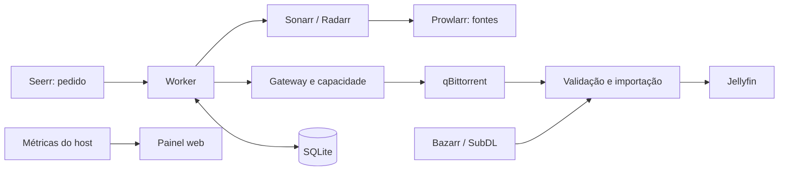

# Arquitetura

HomeServer reúne serviços de mídia e um controlador Python com SQLite.
A stack é iniciada pelo `compose.yaml` da raiz. O `.env` contém credenciais e
preferências editáveis; paths, portas e URLs internas têm defaults no projeto.

O worker escolhe fontes elegíveis e reserva os bytes pendentes reais.
Episódios podem baixar em paralelo na janela configurada por série;
a importação no Jellyfin mantém temporadas e episódios em ordem estrita. A fonte atual continua durante a avaliação
de uma alternativa; qualidade e edição governam a recuperação. Troca por
velocidade está desligada por padrão e pode ser habilitada no `.env`.
Seeds anunciados são um sinal de disponibilidade, não garantia de throughput.

Filmes são validados e importados individualmente. Uma busca de legenda pendente
não impede que um filme válido apareça no Jellyfin nem exige esperar os demais
filmes do lote. O worker continua a recuperação de legendas na prioridade
configurada e informa ao Jellyfin quando instala uma legenda externa. Importações
já aceitas continuam sendo acompanhadas mesmo quando o Seerr passa a considerar
o filme disponível. Séries mantêm sua sequência e suas regras de publicação.

Sonarr/Radarr mantêm Completed Download Handling desabilitado e hardlinks
habilitados: o worker coordena a importação e o torrent pode continuar seedando
sem uma segunda cópia física do vídeo.

O operator configura no Radarr a conexão nativa `HomeServer Jellyfin`, com
atualização da biblioteca após importação, upgrade e renomeação e sem mensagens
aos usuários. Radarr e Jellyfin compartilham os mesmos caminhos lógicos de mídia.
Essa conexão também atende à instalação mergerfs: gravações pelos caminhos dos
discos físicos podem não chegar ao monitor de arquivos da união. Uma varredura
manual recupera importações anteriores à configuração da conexão.

As coleções usam o recurso nativo do Jellyfin, habilitado por
`HOMESERVER_JELLYFIN_AUTO_COLLECTIONS` na biblioteca gerenciada de filmes.
A varredura agrupa filmes pelos metadados de coleção do TMDb, sem copiar mídia.
O agendamento da tarefa de varredura é configurado no painel do Jellyfin.

O operator é um comando pontual do Compose para aplicar preferências nativas,
com leitura antes/depois e IDs preservados. O init prepara configurações
ausentes; bancos existentes não são substituídos.

`/srv/appdata` guarda bancos/configurações dos aplicativos. Torrents e biblioteca
compartilham `/srv/data`; transcode usa `/srv/transcode`. Estado/snapshots do
controle ficam em `/srv/appdata/control`, montado como `/run/homeserver` nos
containers. A porta nativa qBit não é publicada. O serviço `qbit-monitor`
oferece a interface administrativa completa, com autenticação nativa, por
loopback/Tailscale. Ações manuais do proprietário são diretas; aquisições
automatizadas seguem o gateway e os controles de capacidade.

Jellyfin tem escrita na mídia para edição de metadados e legendas. Seu proxy
mantém a exclusão coordenada de filmes, episódios e temporadas pelo controlador;
coleções e seus vínculos são administrados nativamente, sem remover os filmes.
O reconciler garante permissões administrativas, de coleções, legendas e letras
para a conta configurada, preservando os demais campos e outros usuários.

O container de métricas lê CPU, memória, rede e filesystem do host e alimenta
o painel. A operação cotidiana usa Compose; não há gerenciador de releases,
backups, units do host ou CI/CD. Os documentos de produtização anteriores
registram uma abordagem que foi retirada do escopo.

## Evolução para Proxmox e vários nós

A [análise do homelab de novembro de 2026](architecture/homelab-2026/README.md)
reúne o as-is, uma proposta de to-be com isolamento por VMs, os limites de
armazenamento e os gaps para evolução horizontal. É documentação de desenho
para revisão; não altera a implantação Compose descrita neste guia.
