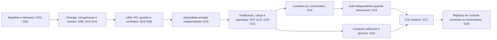

# Gaps e evolução do homelab

Data: 14/11/2026. Este backlog descreve trabalho futuro e evidência necessária. Não constitui autorização para modificar mounts, dispositivos, firewall do roteador ou serviços em produção. A etapa atual entrega somente documentação. Prioridades indicam dependência e impacto; não estimam esforço sem ensaio.

## 1. Gaps priorizados

| ID | Prioridade e momento | As-is → resultado necessário | Critério de aceite |
|---|---|---|---|
| G01 | P0, antes da migração | Hardware e rede declarados → baseline real sanitizado | Conferir RAM útil, ocupação/saúde SSD, USB/UUID, NICs, IOMMU, IP WAN/CGNAT/IPv6 e ACLs sem publicar inventário bruto |
| G02 | P0, antes da migração | Working tree extenso → versão reproduzível do corte | Identificar exatamente arquivos/imagens/configuração em uso e preservar alterações; não confundir HEAD com implantação |
| G03 | P0, antes da exposição nova | Containers no mesmo host → edge/playback/core em VMs e zonas | Testes negativos bloqueiam gestão, core e LAN a partir da VM pública, tanto por IPv4 como IPv6 |
| G04 | P0, decisão confirmada | Jellyfin RW → leitura de mídia, escrita privada | Export do servidor e cliente RO; tentativa de gravação pela identidade privilegiada de teste da playback falha; funções privadas de metadados/legendas verificadas |
| G05 | P0, separação de playback | Guard de ext4/UUID local → contrato de NFS para leitor | Entrada da playback recusa mount ausente/errado; não grava no diretório vazio local; reconexão não apaga biblioteca |
| G06 | P0, manter integridade | Controller, banco, hardlinks e UUID locais → colocação preservada no core | Fixture temporária prova importação, hardlink, espaço, exclusão coordenada e USB ausente/estrangeiro no convidado |
| G07 | P0, acesso público | Proxy e firewall presentes em código → controles efetivos comprovados | Origem externa testa login comum, admin negado, backend direto inacessível, headers/CSRF/token, WebSocket/Range; reboot/restart conserva regras |
| G08 | P0, recuperação | Um disco/host e estado local → retorno e cópia recuperável | Copiar estado de forma consistente para destino independente disponível; restauração isolada validada; definir perda e tempo aceitáveis |
| G09 | P1, estabilidade | Recursos sem orçamento global → limites por VM e tarefas | Carga com 1/5/10 sessões sem OOM, SSD cheio ou degradação além do alvo escolhido; medir direto e transcode separadamente |
| G10 | P1, segurança | Binds do projeto/.env amplos → segredos por consumidor | Processo de telemetry e playback não consegue ler credenciais de controle; auditar mounts e ambiente sem imprimir valores |
| G11 | P1, segurança | Bucket de falhas global → proteção de login sem bloqueio coletivo prolongado | Ensaio isolado demonstra que ataque distribuído não impede todos os novos logins pelo período global atual; preservar limites por origem/conta |
| G12 | P1, operação | Telemetria de um host → visão Proxmox, VMs, USB e capacidade | Distinguir host de guest, margem SSD, temperatura, EIO, SMART quando disponível e idade dos dados; alarmes sanitizados operáveis |
| G13 | P1, manutenção | Pins/tags e scripts de scan → rotina manual de atualização verificável | Scan explícito de imagens e dependências, revisão de advisories/plugins, ensaio de migração de DB e retorno; sem CI/CD novo |
| G14 | P1, contrato inicial; antes de outro escritor | Ledger de torrents → orçamento de storage compartilhado | Quotas/reservas reais e capacidade física contabilizam cada consumidor e seus picos; export/permissões/readiness próprios; thin/PVC não contam como espaço garantido |
| G15 | P2, NAS dedicado | Inspeção local ext4 → backend remoto explícito ou automação co-localizada | Identidade de export/pool, geração, espaço, falha, hardlink e exclusão mantêm garantias; sem falsificar UUID/mountinfo locais |
| G16 | P2, segundo/terceiro nó | Compute único → cluster com quorum e capacidade para falha | Política de 2 nós + qdevice independente ou 3 nós testada; não declarar HA de USB/GPU; verificar reação a partição |
| G17 | P3, quando houver benefício | Compose de instância única → K3s seletivo | PV/afinidade/NetworkPolicy/segredos/healthchecks funcionam; control plane e workloads distribuídos por falhas físicas; sem migração massiva obrigatória |
| G18 | P3, réplicas de controle | SQLite/WAL/arquivos locais → coordenação distribuída | Banco servidor, idempotência, lease/fencing, claims e capacidade transacionais; matar/reiniciar líder não duplica aquisição nem exclusão |
| G19 | P0, fronteira destrutiva | Administrador validado pelo Jellyfin → autorização independente no core | Playback simulada como comprometida não consegue fabricar autorização de exclusão; origem/cookies separados, CSRF e confirmação privada de intenção verificados |
| G20 | P1, operação inicial | Painéis de aplicação → controle completo de infraestrutura privada | Proxmox cria/configura/remove VM de teste, delega ACL por VM, acompanha resultado de tarefas e permanece acessível com core/Grafana fora; SO/rede/aplicação têm políticas próprias |
| G21 | P1, operação inicial | Snapshots locais → métricas históricas, alertas e auditoria | Grafana/Prometheus dentro de orçamento medido, credenciais RO, ausência de dados explícita, alerta e resolução entregues; cobrir recuperação sem progresso e queda total por sonda independente quando disponível |
| G22 | P0, continuidade de energia | HD perde AC enquanto compute segue na bateria → alimentação e parada coordenadas | Nobreak pendente dimensionado por carga/autonomia reais; HD energizado durante flush, consumidores param antes do core/host, retorno e perda de comunicação ensaiados; risco residual explícito enquanto não adquirido |
| G23 | P0, migração USB/NFS | Recuperação local opt-in → coordenação Proxmox/core/clientes | Confirmar instalação atual sem presumir ativação; host/guest identificam mesmo disco, exports não servem fallback, clientes revalidam, pausas mantidas e falha repetida não libera geração antiga |
| G24 | P0, retomada segura | Presença/tamanho e chamadas bloqueáveis → prova de dados e watchdog | Corrupção sintética de mesmo tamanho detectada no conjunto em risco; ausência de prova mantém tarefas afetadas paradas; I/O bloqueado gera alerta sem force-unmount ou restart infinito |

P0 é pré-requisito de um corte seguro ou da nova publicação; não implica corrigir o ambiente existente automaticamente. P2/P3 só entram quando surgir a necessidade. [As-is e evidências](as-is.md), [riscos detalhados](security.md).

## 2. Dependências das etapas

O hub independente e o compute adicional podem evoluir em ordens diferentes. Ambos precisam de contratos de dados claros. O teste físico de uma etapa precede a declaração de que ela funciona; não usar aprovação de um diagrama como evidência operacional.

G22 inclui uma aquisição pendente: a preparação do software pode avançar antes dela, mas isso não encerra o risco elétrico. G23/G24 são requisitos da migração e da retomada segura; não prometem recuperar automaticamente todo defeito físico. [Operação](operations.md), [energia e recuperação](power-recovery.md).

## 3. Critérios de teste para o primeiro corte

| Ensaio | Evidência esperada | Não comprova |
|---|---|---|
| Regressões locais Linux/WSL2 Python 3.12 | Checks aplicáveis de lint, unit, contrato, integração e Compose com env de fixture | USB, GPU, firewall externo ou clientes reais |
| Storage em fixture temporária | Hardlink real, rename, mmap/fsync quando requerido, capacidade e recusa de UUID errado; limpeza só da fixture | Integridade de todo acervo |
| RO do leitor | Export servidor recusa escrita mesmo se cliente pedir RW; caminhos administrativos não exportados | Ausência de leitura/exfiltração da mídia |
| USB ausente/RO/reconexão controlada | Escritas e exclusões suspensas; nenhuma gravação no filesystem raiz; retomada com mesma identidade | Recuperação de falha física, fonte/cabo ou perda de energia não ensaiada |
| Contenção de VM pública | Conexões a Proxmox/SSH/Arr/qBit/LAN/IPv6 falham; NFS RO e upstreams previstos funcionam | Segurança diante de comprometimento do hypervisor |
| Política pública | Token admin negado na entrada pública; usuário comum sem exclusão; origem e headers falsos não elevam privilégios | Ausência de vulnerabilidades desconhecidas do Jellyfin |
| Autoridade de exclusão | Jellyfin falso não pode afirmar identidade admin e provocar exclusão no core; conteúdo da playback não compartilha origem/credencial da confirmação privada | Segurança de uma conta administrativa independente já comprometida |
| Clientes | Browser, TV e celular: login, renovação/revogação, busca, imagem, seek, legenda e playback | Comportamento de todos os dispositivos/codecs |
| Carga 1 → 5 → 10 | Medir throughput, transcode, latência, RAM, espaço/cache, temperatura e erros; escolher SLO antes | Dez transcodes com qualquer codec/resolução |
| Reboot coordenado | Storage pronto antes dos consumidores, firewall antes de publicação, ausência segura do USB | Failover para outro host |
| Retorno isolado | Restaurar banco/config compatíveis, validar IDs e estado sem tocar nos originais | Que snapshots locais protegem contra falha do disco |
| Gestão por VM | CRUD em VM de teste, ACL restrita, tarefas concluídas e acesso Proxmox independente do core | Que ACL do hipervisor configura usuários dentro do guest |
| Corrupção e processo bloqueado | Conteúdo sintético de mesmo tamanho adulterado é detectado; watchdog aponta falta de progresso e mantém espera | Que tamanho correto ou cron ativo provam integridade/disponibilidade |
| Falha entre host/core/NFS | Nova geração exige revalidação; clientes não escaneiam fallback e pausas manuais persistem | Recuperação universal de USB, D-state ou handles antigos |
| Energia e nobreak | Autonomia, ordem de desligamento e retorno demonstrados com cargas/dispositivos autorizados | Que a bateria do notebook mantém a fonte externa do HD ligada |

As mudanças futuras devem preservar os testes de download protegido, importação, exclusão Jellyfin, mounts singleton e política pública já existentes. Testes de filesystem reais usam diretórios próprios e temporários; nunca apontar a suíte de testes ao acervo. Não desconectar USB em escrita para “testar” sem uma janela e procedimento autorizados.

## 4. Migração proposta e pontos de retorno

1. **Descobrir sem mutar:** conferir layout, espaço, dependências e acesso privado; escolher destino de cópia consistente. O USB de mídia não deve ser a única cópia do estado crítico que depende dele. Identificar se algum SSD está em uso para SO/dados; instalar Proxmox pode sobrescrever o disco escolhido.
2. **Preparar ensaio:** construir a divisão de configuração em área isolada com dados sintéticos ou cópias privadas consistentes. Definir dispositivos exatos e janela antes de qualquer instalação, montagem ou passthrough. Não usar o plano histórico de consolidação de discos como autorização para esta migração.
3. **Preparar retorno:** preservar imagens, configuração, versões de DB e montagem original. Snapshots de VM não devem ser considerados cópia do USB em passthrough. Conferir leitura da cópia e restauração isolada antes do corte.
4. **Quiescer escritores:** suspender aquisições e tarefas que escrevem; preservar pausas manuais. Parar processos que alteram DB antes da cópia consistente, incluindo WAL/journals ou API de backup apropriada. Não copiar apenas um `.sqlite` ativo e ignorar seu WAL.
5. **Migrar core:** entregar USB a uma única VM, validar identidade e fixtures, preservar paths lógicos, UID/GID, permits/claims, hardlinks e IDs. `hdd3` pode continuar como identidade histórica; não renomear só por haver um único disco. Não formatar, reparticionar ou copiar toda a mídia se o passthrough preservado bastar.
6. **Migrar playback:** banco/config em SSD próprio, NFS RO validado, entrypoint apropriado e fluxo privado de alterações. Desabilitar efeitos de remoção automática decorrentes de mount ausente até comprovar o comportamento. Testar atualizações explícitas da biblioteca porque notificações locais podem não atravessar NFS.
7. **Validar borda:** regras de firewall, TLS, apps e administração privada antes de redirecionar o tráfego. Reutilizar entrada pública só depois da prova do caminho efetivo. Mudanças no roteador precisam de escopo/autorização próprios.
8. **Observar:** acompanhar estado, temperatura, uso de SSD, USB e clientes na janela escolhida. Registrar resultados sanitizados e exceções; nenhuma limpeza automática do acervo.

**Abortar ou manter serviço parado** se houver UUID/mount incorreto, perda de hardlinks, banco inconsistente, escrita pública, origem desconhecida, falha de isolamento, falta de espaço ou transcode instável. Antes de reativar o desenho anterior, desligar os novos escritores e garantir posse exclusiva do USB. Se o banco sofreu migração de schema, usar conjunto compatível de imagem e banco preservados; downgrade cego não é retorno seguro. Novas escritas após o corte exigem reconciliação, não restauração cega por cima delas.

## 5. Decisões confirmadas e pendentes

| ID | Decisão | Situação e efeito |
|---|---|---|
| D01 | Público com login; gestão privada | Confirmado pelo proprietário |
| D02 | Mídia RO no Jellyfin; alterações privadas | Confirmado para o to-be; muda a experiência de edição/legendas no corte futuro |
| D03 | Proxmox + três VMs e Compose agora | Recomendação; evita K8s competir com as aplicações nos 16 GB |
| D04 | Core agrupa storage + automação na primeira etapa | Recomendação transitória; aceita o risco de escrita dos serviços privados |
| D05 | Seerr privado inicialmente | Recomendação de escopo; pedidos públicos exigem incluir seus fluxos e riscos na borda |
| D06 | Entrada pública existente, encaminhamento ou VPS/túnel | Pendente de inspeção IP/CGNAT/IPv6 e equipamento de rede; nenhuma porta nova autorizada aqui |
| D07 | Permissões, interface e escopo da edição privada | Definir equivalentes de edição/legendas e confirmação destrutiva em origem independente; autenticação nativa Jellyfin sozinha não autoriza exclusão no core |
| D08 | RPO/RTO de estado e mídia | Proprietário deve definir perda de dados e tempo de parada aceitáveis; acervo recuperável e material insubstituível podem ter políticas diferentes |
| D09 | Destino independente para recuperação e janela de migração | Autorizadas cópias privadas no HD de 18 TB e Windows; checkpoint de configuração verificado. Cópia consistente final e teste de retorno pendentes. O proprietário avisará quando puder haver parada |
| D10 | NAS dedicado e escolha de produto | Depois de confirmar recursos, GUI desejada, discos e rede; Linux NFS é o baseline, não decisão de comprar hardware |
| D11 | Quais serviços merecem Kubernetes | Decidir por necessidade de operação/escala; Jellyfin, Arr e controlador não precisam migrar juntos |
| D12 | Controle completo e visibilidade central | Requisito confirmado; proposta: Proxmox + Grafana + operação HomeServer em entrada privada; acesso direto Proxmox preservado |
| D13 | Reintegração automática do USB | Requisito confirmado, condicionado a identidade, integridade, capacidade e readiness; casos inseguros permanecem em espera |
| D14 | Nobreak | Aquisição pendente confirmada pelo proprietário; modelo, carga, autonomia, comunicação e religamento a verificar |
| D15 | Alertas e identidade privada | Definir canal de notificações, MFA e papéis delegados; Grafana Alerting inicial proposto, sem canal operacional comprovado |

O desenho pode ser fechado em camadas: confirmar D03–D05 para a topologia inicial; resolver D06–D09 antes do plano operacional; manter D10–D11 como critérios de evolução. Não é necessário decidir agora a tecnologia de storage distribuído de um cluster que ainda não existe.

## 6. Limites e riscos aceitos apenas como proposta

- Um host + um USB não tolera a perda de nenhum deles. Mais computes não corrigem esse ponto único.
- Playback RO impede escrita pela exportação; um atacante com leitura ainda pode copiar mídia e dados acessíveis. Edge/proxy/TLS não elimina bugs do aplicativo.
- Core concentra os escritores privados; comprometê-lo pode alterar o acervo. A migração inicial reduz a fronteira pública, sem transformar automação em confiável por definição.
- Sem barreira de rede independente, comprometimento do Proxmox pode alcançar a LAN; VLAN sem ACL não basta.
- Sem orçamento de failover, quorum e storage acessível, três nós não significam HA. GPU/USB têm afinidade física.
- Sem destino independente e teste de restauração, perda permanente de dados continua possível. O projeto permanece sem gerenciador de backups.

## 7. Verificação desta entrega documental

Revisão estática, links locais, consistência entre decisões e diagramas e checagem de whitespace são os checks apropriados a esta entrega. Não se afirma aprovação da suíte do aplicativo, scan de CVEs, funcionamento da VM, desempenho ou isolamento físico. Os resultados concretos da checagem documental acompanham a entrega; todos os testes operacionais acima permanecem futuros.
