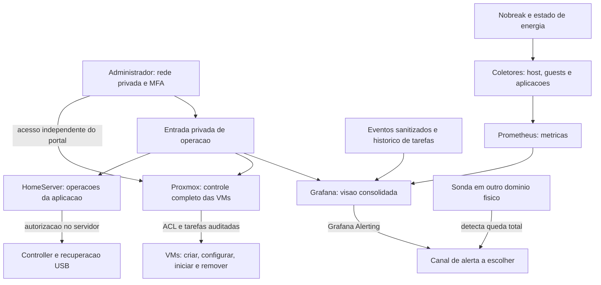

# Observabilidade, administração e governança

Proposta de 14/11/2026. O proprietário confirmou que quer **visibilidade e controle completos**, incluindo criar/remover VMs, alterar recursos e administrar o acesso de cada VM. Este documento define a cobertura e as fronteiras; não instala painéis nem altera permissões.

## 1. Uma área privada de operação

A recomendação é **Grafana para visão consolidada, Proxmox para controle da infraestrutura e HomeServer para operações da aplicação**. A entrada privada reúne os links e o contexto de host/VM/serviço. O console Proxmox continua acessível diretamente pela rede de gestão, mesmo se o portal, o core ou Grafana estiverem parados. A primeira entrega integra consoles existentes; uma tela própria que reproduza todas as funções do Proxmox seria outro projeto.

As setas de telemetria representam fluxo de dados; não autorizam conectividade geral entre zonas. Grafana não recebe token de administrador Proxmox, socket Docker nem chave de exclusão do controlador. Links levam ao console que valida a sessão e a permissão. Ações comuns poderão usar um backend privado com permissões específicas; credenciais de infraestrutura nunca ficam no JavaScript do navegador, variáveis do dashboard ou URLs. As ações nativas de painel do Grafana são chamadas básicas de API e não substituem essa camada. [Grafana: links e ações](https://grafana.com/docs/grafana/latest/visualizations/panels-visualizations/configure-data-links/).

### Cobertura administrativa

| Objeto | Controle oferecido | Autoridade e limite |
|---|---|---|
| VMs | Criar, clonar quando suportado, iniciar, desligar, reiniciar, console e remover | Proxmox; acompanhar o resultado da tarefa, capacidade e dependências |
| Recursos | CPU, RAM, discos virtuais, NICs, limites e ordem de boot | Proxmox; hotplug depende da configuração e suporte do guest; algumas alterações exigem parada |
| Discos de VM | Criar/anexar/expandir conforme backend | Expandir disco virtual não expande automaticamente partição/filesystem do guest; redução não é uma operação genérica segura |
| Acesso por VM | Usuários/grupos, papéis, ACLs por VM/pool, console e energia | ACL Proxmox controla o hipervisor; não cria usuário Linux nem conta Jellyfin |
| Rede | Zonas, NIC/VLAN, firewall e regras de entrada/saída | Proxmox e equipamento de rede; regras efetivas testadas em IPv4/IPv6 |
| Sistema convidado | Usuários, SSH, sudo, atualizações e configuração do SO | Gestão autenticada do guest; acesso ao console é um privilégio sensível |
| Aplicações | Contas, bibliotecas, fila, pausas, edição privada e exclusões coordenadas | Painéis nativos e API HomeServer; controles de capacidade continuam na automação |
| Storage | Saúde, disponibilidade, exports, permissões e orçamento por consumidor | Hub/NFS; quotas e reservas precisam ser implementadas no backend adequado |
| Recuperação | Estado, motivo da espera, histórico, desativação e retomada autorizada | Coordenador de recuperação; botão não ignora UUID, integridade, capacidade ou manutenção |

O painel Proxmox já possui gestão de VMs, hardware, console e tarefas. Suas permissões distinguem alocação, energia, configuração e auditoria. Uma conta humana proprietária pode ter administração completa; coletores e automações usam identidades próprias com o menor alcance necessário. A separação de privilégios dos tokens limita a permissão à interseção das ACLs do token e do usuário. Validar os nomes de privilégios na versão instalada. [GUI](https://github.com/proxmox/pve-docs/blob/master/pve-gui.adoc), [ACLs e tokens](https://github.com/proxmox/pve-docs/blob/master/pveum.adoc), [VMs](https://github.com/proxmox/pve-docs/blob/master/qm.adoc).

**Excluir VM tem um escopo explícito:** mostrar VM, discos virtuais que serão removidos, dependentes e recursos externos. USB em passthrough, export compartilhado e dados de outro consumidor não são lixo da VM. Excluir o core derruba o hub e a automação: precisa de confirmação de impacto e de um caminho de recuperação. O desenho não autoriza exclusão automática de mídia nem operações de disco em produção.

## 2. Autorização e trilha de mudanças

Três dimensões de acesso são administradas separadamente: **quem pode operar a VM no Proxmox; quais redes podem alcançá-la; quem pode entrar no SO e nas aplicações**. Cada consumidor de storage também recebe sua política de arquivos. Dar acesso a uma VM não concede acesso às outras, à rede de gestão ou a todos os diretórios do hub.

| Papel proposto | Permissões |
|---|---|
| Proprietário | Administração completa privada; MFA; conta de recuperação local preservada e testada |
| Operador delegado | Ações selecionadas em VMs/serviços definidos; sem elevar o próprio papel |
| Observador | Dashboards e inventário sanitizado; sem operações ou segredos |
| Coletor | Leitura das métricas/objetos necessários; sem console, power management ou configuração |
| Automação | Identidade por função e escopo; sem token global reutilizado entre recovery, telemetria e aplicações |

A futura API de operações deve validar sessão, autorização e origem/CSRF no servidor, registrar intenção e resultado, e evitar duplicação após timeout/reenvio. Operações Proxmox que retornam UPID só terminam quando a tarefa apresenta `stopped` e seu `exitstatus` foi inspecionado; resposta HTTP ou ID de tarefa não significa sucesso. Em timeout, consultar o estado existente antes de criar outra VM ou repetir uma exclusão. [API oficial de tarefas](https://github.com/proxmox/pve-manager/blob/master/PVE/API2/Tasks.pm).

Registro mínimo: horário sincronizado, identidade, ação, alvo, parâmetros sanitizados, estado anterior/posterior pertinente, ID da operação/tarefa e resultado. Nunca registrar senha, token, URL de sessão ou `.env`. Inventário deve relacionar host → VM → serviço → volume/export, responsável, finalidade, dependências e recursos previstos. Histórico local pode ser alterado por um administrador comprometido; trilha resistente a esse cenário exige cópia externa com autoridade distinta, ainda não disponível.

## 3. O que existe hoje

| Evidência local | Limite atual |
|---|---|
| [Host metrics](../../../scripts/host-metrics.py) e [serviço no Compose](../../../compose.yaml#L935) coletam CPU/RAM, temperatura, uptime, rede e storage | Snapshot JSON substituído atomicamente; não há série histórica de cluster |
| [Telemetry](../../../services/telemetry/src/homeserver_telemetry/app.py) expõe status e interface; [provider](../../../services/telemetry/src/homeserver_telemetry/status.py) considera idade das evidências | Não equivale a exporter Prometheus; endpoints e métricas novos precisam de contrato |
| Heartbeat e ciclo do worker persistem saúde e último resultado | Processo vivo não prova progresso nem sucesso do último ciclo |
| [Outbox de alertas](../../../services/telemetry/src/homeserver_telemetry/alerts.py) e [transporte](../../../services/telemetry/src/homeserver_telemetry/notifications.py) têm deduplicação/retry | Não foi encontrada instanciação/rotina de envio em execução no código inspecionado; não declarar alertas operacionais |
| Compose usa rotação local de logs Docker | Limite de bytes não é retenção temporal garantida, busca central nem auditoria independente |
| Operações persistidas no controlador | Não há trilha completa integrada de Proxmox, guests, rede e aplicações; inventário de rotas não comprova handler de eventos implementado |

O endpoint de fila em memória não deve ser tomado como inventário autoritativo de todos os trabalhos. Os painéis devem usar estados persistidos de downloads, permits, importações e exclusões, com idade e fonte da evidência. Nenhum desses componentes foi inspecionado em produção nesta análise.

## 4. Stack recomendada e orçamento

| Etapa | Componentes | Condição |
|---|---|---|
| Inicial | Proxmox nativo + Grafana + Prometheus; um único mecanismo de regras/notificações, inicialmente Grafana Alerting | Coletores por necessidade; métricas HomeServer ainda exigem adaptação; tudo privado |
| Após medição | Alloy + Loki para logs sanitizados selecionados | Limitar ingestão/retenção e consumo antes de incluir todos os containers |
| Quando houver necessidade | Traces OpenTelemetry e backend correspondente | Útil para diagnosticar latência entre serviços; não obrigatório para o primeiro nó |
| Com outro domínio físico | Sonda externa ao compute e destino de alerta independente | Detecta host/rede/stack inteira fora do ar; sonda na mesma VM não cobre essa falha |

Grafana é a recomendação por reunir métricas e, depois, logs com o mesmo contexto. Zabbix é alternativa se o foco passar a ser inventário, disponibilidade e administração de muitos equipamentos com fluxos próprios. Netdata pode ajudar no diagnóstico imediato, mas adicioná-lo junto de todos os coletores cria duplicidade. Não há ganho em instalar as três opções agora. [Grafana](https://grafana.com/docs/grafana/latest/), [Zabbix](https://www.zabbix.com/documentation/current/en/manual/web_interface/frontend_sections), [Alloy](https://grafana.com/docs/alloy/latest/introduction/), [Netdata](https://learn.netdata.cloud/docs/netdata-parents/).

**Os 16 GB já têm orçamento no [to-be](to-be.md).** Grafana/Prometheus começam dentro do orçamento de 6 GiB do core, em containers separados, com teto conjunto experimental de 1 GiB a validar; isso reduz a memória disponível à automação. Não é previsão de consumo nem garantia de que caberá. Se houver OOM, pressão de memória ou latência de controle, reduzir séries/retenção/tarefas e reavaliar RAM antes de avançar. A margem de 2 GiB do host não está simultaneamente disponível para uma quarta VM. Loki e Immich não entram escondidos nessa conta. Separar monitoramento em VM própria é evolução após redimensionamento; o painel nativo Proxmox permanece independente do core.

Métricas e configuração ficam em disco virtual SSD, fora da união de mídia. Como ponto de partida de ensaio: coleta de infraestrutura a cada 30 s, aplicação a cada 60 s, retenção de métricas de 7 dias e limite de TSDB de 4 GiB dentro de volume de 8 GiB. Grafana/configuração e logs têm orçamentos separados. Ajustar com cardinalidade/ingestão reais; retenção TSDB não é quota rígida para todos os arquivos, e WAL/head exigem folga. Alertar sobre espaço livre; não deixar observabilidade encher o SSD do controlador. Prometheus local não deve usar um filesystem NFS. [Armazenamento Prometheus](https://prometheus.io/docs/prometheus/latest/storage/).

Coletores de hardware leem o host; métricas de VM vêm da API Proxmox; métricas de sistema/aplicação vêm do guest. SMART/temperatura do USB podem estar indisponíveis pela bridge/passthrough e devem aparecer como **desconhecidos**. Um coletor de containers que precise de acesso amplo ao host ou socket Docker deve ser avaliado como componente privilegiado; socket montado `:ro` não transforma a API Docker em somente leitura. Não instalar agentes duplicados em cada camada sem uma necessidade de dado definida.

## 5. Dashboards e alertas

| Painel | O que precisa responder |
|---|---|
| Visão geral | Quais hosts, VMs, serviços e dependências estão saudáveis, degradados ou sem dados? Há incidente de energia/storage? |
| Compute e VMs | CPU, RAM real/pressão, swap/OOM, temperatura/throttling, I/O SSD, recursos provisionados, estado e tarefas Proxmox |
| Storage e energia | Presença/identidade/geração USB, mount e export corretos, EIO/RO, latência, capacidade física/compromissos, fase/idade da recuperação, bateria do laptop e nobreak |
| Media | Sessões, direct play/transcode, erros, banda e transcode/cache; métricas suportadas pela versão/API, sem presumir exporter pronto |
| Automação | Último ciclo bem-sucedido, atraso, downloads/permits por estado, idade de importações/exclusões, bloqueios por capacidade e retomadas suspensas |
| Acesso e mudanças | Falhas de login agregadas, decisões de bloqueio, alterações de ACL/VM/rede e resultado de tarefas; sem tokens ou histórico detalhado de consumo |
| Observabilidade | Coletores/targets fora, idade dos snapshots, falhas de entrega, espaço/retenção e carga da própria stack |

Labels de métricas têm cardinalidade limitada: host, VM, serviço, pool e estado enumerado. Títulos de mídia, paths, infohashes, usuários e IDs de operação ficam fora das labels; detalhes sanitizados, quando necessários, pertencem a eventos com acesso restrito. Prometheus e exporters não são interfaces públicas.

Alertas iniciais: USB ausente/identidade divergente, mount RO/EIO, recuperação sem progresso, pouco espaço, worker atrasado, OOM, temperatura alta, export indisponível, falha de autenticação anormal e nobreak em bateria/baixo nível/perda de comunicação. Cada regra precisa de duração, severidade, responsável, runbook e condição de resolução. Alarmes derivados dos consumidores são agrupados/suprimidos durante incidente conhecido de storage, sem esconder o alarme principal.

O watchdog de recuperação mede **progresso persistido**, e não só existência do processo. Chamadas de filesystem podem bloquear; o monitor deve continuar lendo estado no SSD e sinalizar atraso. Se o compute inteiro travar, somente a sonda em outro domínio poderá detectar. A queda do próprio Grafana impede seus alertas: o teste externo deve cobrir isso.

## 6. Aceite e evolução

1. Criar, configurar, delegar acesso, desligar e excluir uma **VM de teste**; registrar tarefas e provar que o usuário delegado não alcança outra VM, host ou export.
2. Mostrar a diferença entre configurar RAM/disco e o guest reconhecer a mudança; alteração que exige reboot aparece como pendente.
3. Simular falta de dados e indisponibilidade do coletor: Grafana saudável mostra desconhecido/atrasado. Na falha do core, seu Grafana/Prometheus também podem parar; a evidência passa ao Proxmox e à sonda independente, quando existente. Confirmar acesso privado direto ao Proxmox nessa condição.
4. Demonstrar que credenciais de observação não conseguem criar VM, mudar firewall ou executar ação no controlador; nenhuma credencial administrativa chega ao navegador via dashboard.
5. Exercitar alerta e resolução com dados sintéticos, deduplicação, manutenção e canal escolhido. Um módulo de envio sem consumidor ativo não satisfaz o aceite.
6. Medir a stack de observabilidade sob carga de mídia; incluir seu SSD/RAM no orçamento global e na [recuperação de energia/USB](power-recovery.md).

Permanecem pendentes o canal de notificações, a identidade/MFA privada, políticas delegadas concretas e o orçamento medido. Controle completo é o requisito confirmado; esta composição de consoles e ferramentas é a solução proposta.
