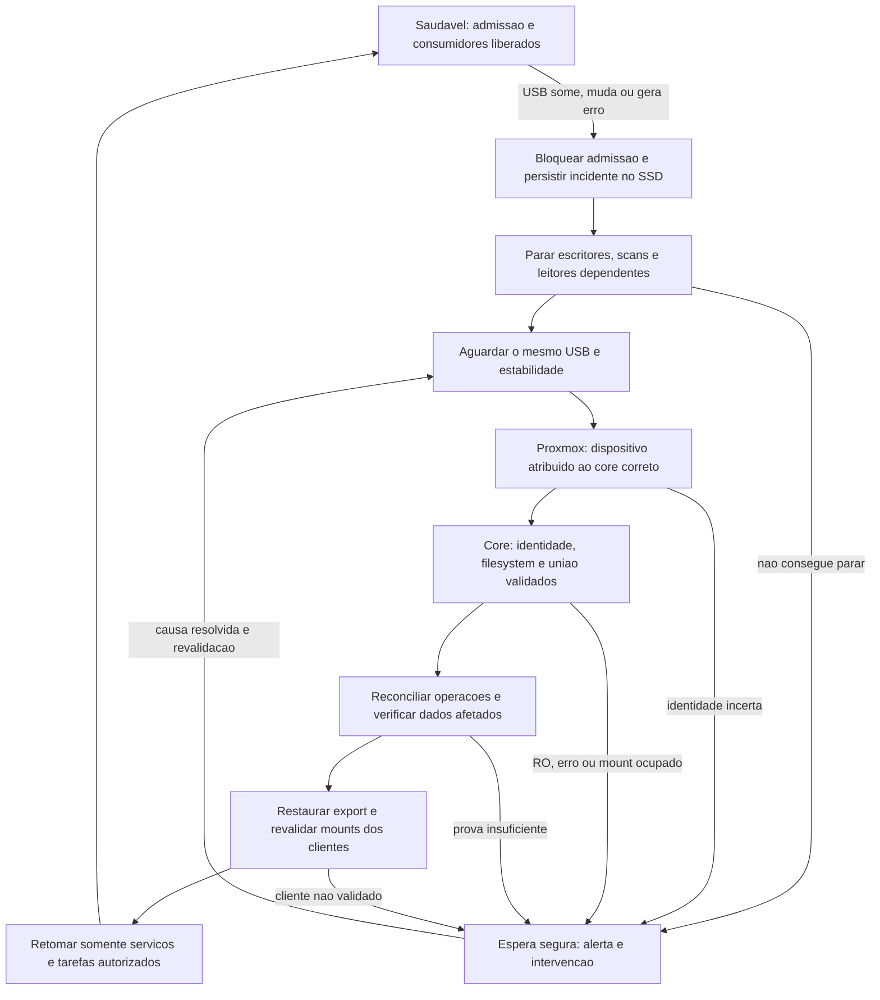

# Energia, falha do USB e reintegração automática

Proposta de 14/11/2026. O proprietário relata que o servidor continua na bateria quando acaba a energia, enquanto a fonte externa do HD USB desliga. Confirmou **reintegração automática como requisito e nobreak como pendência de aquisição**. Não houve inspeção física, instalação, teste de desligamento ou alteração dos mounts.

## 1. A falha e as duas proteções necessárias

A bateria do notebook sustenta o compute, mas não fornece energia à fonte AC separada do HD. A perda súbita do USB pode deixar I/O em erro, mounts antigos, processos bloqueados e escritas incompletas enquanto o restante do servidor segue ligado. Essa é a hipótese consistente com o relato; logs e ensaio controlado ainda precisam caracterizar o comportamento concreto.

**Prevenção elétrica:** alimentar a fonte do HD e o carregador do servidor no mesmo nobreak; incluir switch/roteador necessários ao acesso/encerramento coordenado. Dimensionar por potência em watts, VA, pico de partida e autonomia medida com as cargas reais. Escolher equipamento com monitoramento compatível, por USB ou rede, se for usar NUT. Não foi escolhido modelo nem capacidade. A bateria interna ajuda o compute, mas não substitui essa proteção do storage.

**Recuperação por software:** bloquear novas operações, interromper consumidores, verificar retorno do mesmo disco, restaurar mounts/exports e revalidar os clientes antes de retomar. Isso também cobre desconexões por cabo/bridge; não restaura bytes que nunca chegaram ao disco nem conserta hardware defeituoso. Um único HD continua sem redundância.

## 2. O que o projeto já implementa

| Mecanismo encontrado | Evidência e limite |
|---|---|
| Recuperação opt-in por cron, uma execução por minuto | [Instalador](../../../scripts/install-usb-recovery.py#L129); não foi confirmado se está instalada/ativa no servidor |
| Layout com somente `hdd3` | [Configuração](../../../services/common/src/homeserver_common/usb_recovery.py#L123) e [fixtures singleton](../../../tests/unit/test_single_media_usb_recovery.py); não exige os discos dos layouts antigos |
| Estado persistente e lock exclusivo | [Controlador](../../../services/common/src/homeserver_common/usb_recovery.py#L223), [launcher](../../../scripts/usb-recovery.py#L46); preservar em SSD interno/disco virtual SSD, posição física que o código não atesta |
| Verificação de UUID, serial da bridge, partição, tamanho, ext4, RO e geração | [Identidade](../../../services/common/src/homeserver_common/usb_recovery.py#L160); disco diferente/ausente/RO mantém espera |
| Parada e retomada somente dos containers antes ativos | [Quiesce](../../../services/common/src/homeserver_common/usb_recovery.py#L649), [restauração](../../../services/common/src/homeserver_common/usb_recovery.py#L670); respeita manutenção e pausas capturadas antes do incidente; intenção nova durante a recuperação requer reconciliação explícita no to-be |
| Debounce de geração e revalidações | [Estados](../../../services/common/src/homeserver_common/usb_recovery.py#L323); mínimo de 15 s entre observações, combinado com cron e transições pode levar vários minutos; não é observação contínua nem SLA |
| Autorizações/capacidade antes da retomada | [Provas das fontes](../../../services/common/src/homeserver_common/usb_recovery_sources.py#L145); não cria nova autorização para contornar uma pendência |
| Payload concluído presente e tamanho exato | [Validação](../../../services/common/src/homeserver_common/usb_recovery_sources.py#L130); não calcula hash do conteúdo: corrupção de mesmo tamanho pode passar |

O instalador não formata, não edita `fstab` e não cria novas units próprias. O fluxo opera mounts já cadastrados e suas units existentes, conforme o [guia atual](../../../docs/storage.md). Encontrar código/testes não comprova que esse fluxo funcione no disco, bridge, kernel ou versão qBit do servidor.

Há timeouts de subprocessos e condições de espera para consumidor/mount ocupado. Entretanto, chamadas diretas de filesystem, como `stat()` e `getxattr()`, podem bloquear sem deadline e reter o lock; novas execuções podem apenas encontrar `busy`. Processos em espera de I/O no kernel podem não parar dentro do prazo. O desenho precisa de watchdog independente e caminho de intervenção, sem prometer que `docker stop` sempre resolve.

## 3. Contrato de recuperação no Proxmox

Os estados descrevem o **to-be**, ampliando o mecanismo local existente. Não há hoje orquestração pronta entre hypervisor, core e clientes NFS. A recuperação deve ter uma única autoridade por incidente, com persistência, lock/geração e etapas idempotentes; uma tentativa antiga não pode reabrir admissões após outra falha.

1. **Detectar e conter.** Combinar eventos do sistema com checagens periódicas e guards em cada operação. Fechar admissão, importação, exclusão e scans assim que a falha for observada; não esperar o cron para autorizar novas escritas. Persistir estado no SSD e registrar quais consumidores/tarefas estavam ativos. A detecção não elimina a janela anterior à observação nem I/O já em voo.
2. **Parar todos os dependentes.** Incluir qBit/Arr/controlador e também Jellyfin remoto, indexações e futuros consumidores como Immich. Confirmar quiescência dos clientes, suspender novas conexões e retirar os exports afetados antes de desmontar o backing filesystem; conferir referências/mounts ocupados do servidor NFS. Parar apenas o aplicativo remoto não prova que `nfsd` liberou o volume. Interface administrativa e monitoramento devem funcionar sem a mídia; processos dependentes bloqueados não devem monopolizar sua capacidade. Se não for possível confirmar parada/liberação, manter o incidente aberto, sem remontagem forçada.
3. **Confirmar a camada física e o passthrough.** Proxmox deve atribuir o dispositivo somente ao core autorizado. A identificação por vendor/product não distingue duas bridges iguais; porta muda com a topologia. Registrar o mapeamento e validar a identidade no guest. Não usar `/dev/sdX` como identidade nem montar para escrita em host e VM ao mesmo tempo.
4. **Revalidar no core.** Mesmo disco/partição, geração atual, mount esperado, ext4 utilizável, permissões e união coerentes. Diretórios de fallback não podem receber dados. Manter manutenção/pausas previamente escolhidas. A simples presença do dispositivo USB não significa storage pronto.
5. **Reconciliar escrita interrompida.** Preservar journals e provas; conferir operações pendentes e dados potencialmente afetados. Tamanho/descriptor não provam conteúdo íntegro. Para payloads torrent afetados, prever verificação de pieces por fluxo controlado que mantenha transferências pausadas e não inicie redownload automaticamente. Para arquivos sem checksum conhecido, registrar a limitação e exigir verificação/restauração apropriada antes de liberar trabalho dependente. Não é necessário prometer hash de 18 TB em toda reconexão; o conjunto em risco precisa ser delimitado, ou a dúvida permanece pendente.
6. **Restabelecer NFS e clientes.** Export só existe sobre mount correto; usar condição `mountpoint`/equivalente e readiness adicional para não servir o diretório vazio subjacente. Cada cliente deve revalidar export/geração, mount e leitura de fixture inofensiva; tratar handles antigos. Playback continua RO no servidor e no cliente. Biblioteca temporariamente ausente não é autorização para remover itens.
7. **Retomar por dependência.** Liberar apenas os consumidores revalidados e tarefas com autorização/capacidade preservadas, sem reviver pausas manuais ou duplicar comandos. Reconciliar o snapshot inicial com intenções administrativas posteriores: uma parada/pause durante o incidente prevalece sobre o desejo antigo de iniciar. Outros consumidores permanecem isolados em espera. Atualizar biblioteca apenas após readiness real; emitir evento de conclusão com duração e limitações. Nova perda do USB fecha novamente a admissão.

O Proxmox documenta passthrough USB por vendor/product ou caminho da porta e a disponibilização quando o dispositivo aparece. Isso não garante recuperar I/O, filesystem e aplicações após corte de energia. Reanexação ou reinício do core pode ser necessário; primeiro diagnosticar e definir um procedimento delimitado, sem reboot automático do servidor inteiro como solução padrão. [USB Proxmox](https://github.com/proxmox/pve-docs/blob/master/qm.adoc#usb-passthrough).

NFS `hard` pode manter chamadas esperando; trocar por `soft` para eliminar travamentos tem risco de corrupção e não é a solução genérica. Remounts, invalidação de handles e retomada devem ser ensaiados com os consumidores parados e sem `umount -l`/forçado como rotina. Opens, locks e delegations NFSv4 podem manter o filesystem ocupado: retirar o export exige drenar/revogar o estado pertinente conforme a versão e conferir liberação. `exportfs -ua` isoladamente não revoga esse estado NFSv4. O guard `mountpoint` evita fallback não montado, mas não prova saúde de um mount antigo com EIO. [NFS](https://man7.org/linux/man-pages/man5/nfs.5.html), [exports](https://man7.org/linux/man-pages/man5/exports.5.html), [unexport e estado NFSv4](https://man7.org/linux/man-pages/man8/exportfs.8.html).

### Quando a retomada deve permanecer bloqueada

Disco estrangeiro, UUID duplicado, identidade insuficiente, filesystem RO/com erros, necessidade de reparo, dados possivelmente corrompidos, falta de espaço, lock sem progresso, processos em I/O bloqueado, mount ocupado ou estado de autorização inconsistente exigem espera e diagnóstico. Um botão de “tentar novamente” repete validações; não transforma falha em sucesso.

Não executar `fsck -y`, forçar RW, desmontar à força, apagar arquivos ou recriar mountpoints para contornar a falha. O replay normal do journal ext4 pode recuperar metadados após montagem, mas não demonstra preservação de toda escrita. Reparos precisam de dispositivo exato, filesystem desmontado, avaliação de cópia/restauração e escopo autorizado. [ext4](https://www.kernel.org/doc/html/latest/admin-guide/ext4.html), [e2fsck](https://man7.org/linux/man-pages/man8/e2fsck.8.html).

## 4. Nobreak e desligamento coordenado

Com nobreak compatível, usar NUT e integração suportada pelos pacotes do sistema, sem reintroduzir um framework de units próprias do projeto ou substituir o serviço Lenovo. O monitor de energia precisa ficar no domínio que continua operacional sem o USB de mídia, preferencialmente no host Proxmox. A interface de comunicação do nobreak não deve ser disputada por host e guest. Só aprovar sua configuração após conhecer modelo, driver, cargas e autonomia.

A ordem de desligamento proposta para este desenho é: interromper novas operações → parar consumidores/leitores e escritores → encerrar o core/storage de forma limpa → encerrar o host → desligar a saída do nobreak quando suportado e seguro. Toda a sequência precisa caber na autonomia medida com margem. O desligamento ordenado só ajuda se o HD continuar energizado durante a drenagem e flush; acionar software depois que sua fonte já caiu é recuperação de incidente.

O Proxmox encerra VMs na ordem inversa da inicialização; core deve iniciar antes e parar depois dos consumidores. Atrasos de boot não substituem readiness e timeouts podem levar a parada forçada. NUT coordena sinalização e espera, mas a desconexão de um cliente não prova que todos os dados chegaram ao disco. Definir também perda de comunicação com o nobreak, bateria crítica e queda prolongada. [Ordem das VMs](https://github.com/proxmox/pve-docs/blob/master/qm.adoc#automatic-start-and-shutdown-of-virtual-machines), [NUT upsmon](https://networkupstools.org/docs/man/upsmon.html).

Quando a energia voltar, religamento do host depende do firmware, estado da bateria e comportamento do nobreak. Se o notebook desligar por completo, não presumir que ligará sozinho ao retornar AC. Validar esse requisito em separado. O boot só libera serviços após identidade e readiness, mesmo quando a ordem de inicialização está correta.

## 5. Painel e critérios de aceite

Mostrar energia AC/bateria do laptop, nobreak e sua comunicação, presença e identidade USB, fase/motivo/idade do incidente, última transição bem-sucedida, consumidores bloqueados, validações pendentes e duração da recuperação. Estado desconhecido aparece como desconhecido, sem reutilizar último valor saudável indefinidamente. Separar capacidade indisponível de capacidade zero; nenhuma deve autorizar nova aquisição.

| Ensaio futuro | Resultado exigido |
|---|---|
| Disco ausente ou de identidade errada, em fixture/laboratório | Recusa de admissão e nenhuma gravação no diretório local de fallback |
| Reconexão do dispositivo correto | Host/guest/export/clientes reconhecem a mesma origem; somente dependentes verificados retomam |
| Retorno com mesmo major/minor e nova geração | Mount/binds antigos não passam como saudáveis só pelo nome do dispositivo |
| Queda durante escrita sintética | Conteúdo com hash conhecido é verificado; truncamento e corrupção de mesmo tamanho impedem liberação indevida |
| Pausa manual e manutenção antes/durante incidente | Recuperação não desfaz a intenção do administrador |
| EIO, mount ocupado, lock parado e processo em I/O bloqueado | Alerta por falta de progresso; sem loop de restart, unmount forçado ou sucesso fictício |
| Playback/Immich cliente sem mount | Não escaneia diretório vazio, não remove catálogo, não escreve no rootfs; retorno exige contrato do cliente |
| Falha repetida durante retomada | Geração anterior não consegue liberar o novo incidente; sem duplicação de downloads/exclusões |
| Nobreak em bateria, bateria crítica e perda de comunicação | Políticas e ordem de parada medidas; HD energizado até finalizar I/O |
| Volta da energia após desligamento total | Religamento real conforme hardware; storage pronto antes dos serviços |

Ensaios com interrupção física usam mídia de teste e janela/dispositivos autorizados. Testes unitários não comprovam D-state, passagem USB, fonte, NUT ou clientes NFS reais. O tempo de recuperação será medido; não há RTO de segundos garantido pelo cron atual. RPO zero após desligamento abrupto do HD também não é uma garantia possível deste desenho.

Sem nobreak, a fase inicial ainda pode conter e recuperar falhas verificáveis, aceitando o risco de perda/corrupção de escritas. A aquisição foi registrada como pendência. O trabalho de implementação está nos gaps G20–G24; este documento não ativou nem modificou o mecanismo existente.
