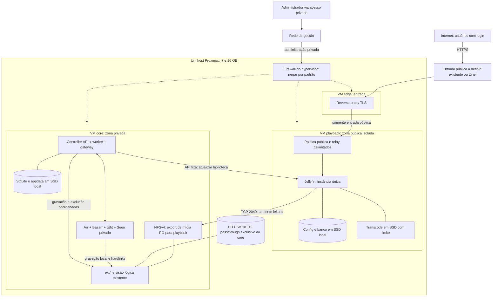
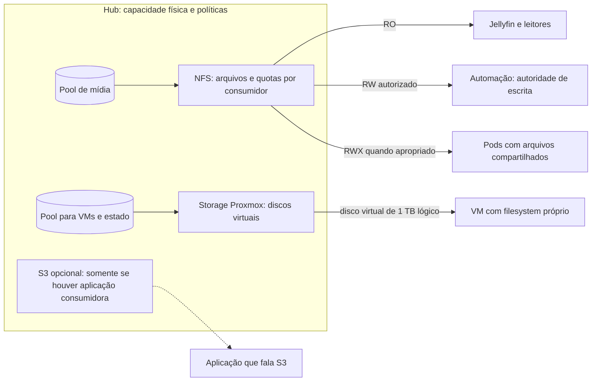
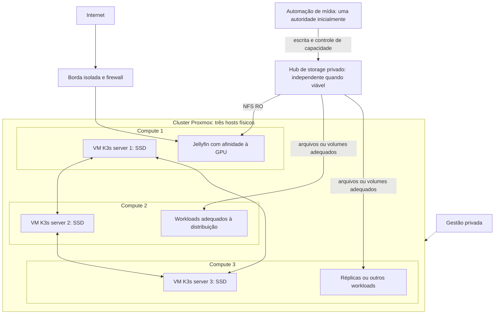

# To-be do homelab

Proposta de 14/11/2026. O proprietário confirmou reprodução pública autenticada, administração privada, **Jellyfin sem escrita na mídia**, controle completo de VMs e reintegração automática do USB após falha. Nobreak é pendência de aquisição confirmada. A divisão de VMs, produtos e etapas abaixo é recomendação para fechar o desenho, não uma implantação já aprovada ou executada.

## 1. Alternativas consideradas

| Caminho | Benefícios | Custos e limitações | Posição |
|---|---|---|---|
| Proxmox + Compose em VMs; storage e automação juntos inicialmente | Preserva o controlador, separa a aplicação pública, cabe melhor nos 16 GB; evolução gradual | Hub e USB únicos; integração de NFS e divisão da stack ainda precisam de trabalho | **Recomendado agora** |
| NAS dedicado + VMs de aplicação | Separa ciclo de vida do storage e dos computes; facilita futuros consumidores | Requer outra máquina/discos; controlador atual precisa adaptação ou execução próxima ao storage | Evolução de médio prazo |
| Proxmox + K3s já no primeiro nó | Aprendizado imediato e linguagem de deployment comum | Mais consumo e operação; não resolve estado, USB, GPU ou disponibilidade; exige refatoração prematura | Adiar no hardware atual |

Proxmox agenda e administra VMs. Kubernetes agenda pods dentro de VMs Linux que funcionam como nós do cluster. Uma VM usa CPU e RAM de **um host por vez**; ter três hosts oferece mais capacidade agregada para várias VMs, não uma única VM somando a RAM dos três. Não instalar o plano de aplicações diretamente no host Proxmox.

## 2. Fase inicial com um compute

As setas mostram fluxos permitidos, não conectividade irrestrita. O firewall deve aplicar as regras também entre VMs; uma bridge/vNIC adicional sem filtro não constitui isolamento. Os containers continuam segmentados dentro de cada VM. Edge não recebe mídia, `.env` global, banco de controle ou acesso ao Proxmox. O caminho administrativo é distinto do público e não é divulgado pelo proxy externo.

**VM core:** manter API, worker, gateway, qBit, Arr, Bazarr, Seerr privado e métricas de convidado. O USB pertence exclusivamente a ela. A automação continua vendo ext4, UUID e `/data` locais; os guards precisam ser ensaiados no convidado. O passthrough deve expor identidade estável verificável, nunca presumir nomes `/dev/sdX`. Não montar o mesmo filesystem para escrita simultaneamente no host e na VM.

**VM playback:** Jellyfin, proxy/política de acesso público e relay estritamente necessários. Configuração e banco do Jellyfin ficam no seu disco virtual em SSD; cache/transcode em área limitada do SSD. A mídia é NFS somente leitura. O guard público, se reaproveitado, mantém apenas seu pequeno estado de login local e nenhuma chave global do controlador. Adaptar os entrypoints que hoje exigem mergerfs e UUID físicos; um mount NFS precisa de outro contrato de saúde.

**VM edge:** proxy reverso com TLS e regras de origem, sem acesso a arquivos. O projeto já tem proxy/políticas próprios: separar responsabilidades antes de introduzir outra ferramenta. Reutilizar componentes mantidos como Caddy/Nginx e preservar os testes de compatibilidade. TLS pode terminar na borda; usar TLS ou túnel autenticado nos trechos que atravessarem redes não confiáveis.

**Compromisso transitório:** storage e automação na mesma VM reduzem o custo inicial e preservam a identidade local, mas uma falha no qBit/Arr ou no núcleo ainda alcança os dados graváveis. NFS também expõe uma superfície do kernel do core ao playback. Um NAS independente melhora essa separação; não cabe afirmar isolamento total do storage nesta fase.

### Escrita, edição e exclusão

O proprietário escolheu mídia RO no Jellyfin. Impor RO na **exportação NFS do servidor** para o cliente playback e também na montagem do cliente/container. Uma montagem cliente RO com export RW pode ser contornada por root na VM. Restringir export ao cliente/rede necessários, manter `root_squash`, impedir spoofing entre zonas e não expor outra export RW ao playback. `AUTH_SYS`/UIDs e `root_squash` sozinhos não são autenticação forte contra cliente comprometido.

Jellyfin continua escrevendo em sua própria configuração/DB e no transcode. Metadados que puderem ser armazenados apenas no appdata podem continuar ali; salvar sidecars, imagens e legendas junto ao vídeo passa à automação privada. Não prometer que todos os botões atuais de edição/legenda continuarão gravando: esse fluxo precisa de adaptação e teste.

Exclusões de mídia são solicitadas apenas pelo caminho administrativo privado e executadas pelo controlador no core. Proposta concreta: manter o proxy administrativo no core; ele encaminha as operações normais ao Jellyfin e intercepta pedidos de exclusão para o controlador local. Isso preserva a direção core → playback e dispensa conexão iniciada pela playback à API do controle. A VM pública não recebe uma chave administrativa do controlador. Sessões públicas continuam sem poder apagar. Marcar como assistido permanece sem efeito destrutivo. A escrita deliberada do Jellyfin no as-is não é alterada por este documento.

**Autoridade independente para destruição:** uma sessão de administrador validada pelo próprio Jellyfin não basta para autorizar exclusão no core, pois uma playback comprometida controla essa resposta. O ingresso privado e o core devem exigir identidade administrativa independente, que a playback não possa emitir, validar ou recuperar, usando mecanismo mantido de autenticação privada ou mTLS. A interface de confirmação destrutiva fica em origem separada do Jellyfin, com autorização no servidor, proteção de origem/CSRF e confirmação da intenção no core. Não compartilhar cookies administrativos com conteúdo servido pela playback. O proxy pode iniciar o fluxo, mas não converter automaticamente um DELETE do Jellyfin em autorização destrutiva. O mecanismo exato é decisão da implementação; o teste de aceitação deve simular Jellyfin comprometido e rejeitar credenciais/intenções fabricadas por ele.

### Orçamento inicial de recursos

| Destino | RAM fixa inicial | vCPU iniciais | Estado persistente |
|---|---:|---:|---|
| Proxmox e serviços de host | 3 GiB de orçamento | Reserva de capacidade do host | SSD, independente da VM storage |
| Edge | 1 GiB | 1 | Pequeno disco SSD; certificados/configuração |
| Playback | 4 GiB | 4 | SSD para config/DB e transcode limitado |
| Core | 6 GiB | 4 | SSD para appdata/SQLite; USB para mídia |
| Margem não alocada | Aproximadamente 2 GiB | — | Absorver picos e medir antes de ampliar |

É um ponto de partida para ensaio com os 16 GB declarados; conferir memória utilizável, sem sobrealocação agressiva. vCPU são escalonadas sobre o processador, não núcleos adicionais. Os dois SSDs de 512 GB não têm layout, saúde ou ocupação verificados: não presumir RAID, pool conjunto ou disponibilidade de 1 TB. Distribuir discos de VM e limitar transcode depois dessa conferência. Mirror de dois SSDs de 512 GB teria aproximadamente a capacidade de um deles; soma de capacidade sem réplica aumenta o impacto da falha de qualquer disco.

Se a carga real não couber, reduzir concorrência/tarefas auxiliares ou ampliar RAM; não tirar a separação entre playback público e core para acomodar Kubernetes. Para três ou mais VMs de infraestrutura adicionais, 32 GB ou mais pode tornar o projeto mais confortável, mas a escolha final depende da medição e do suporte físico do equipamento.

Grafana/Prometheus são propostos dentro dos 6 GiB do core, com teto conjunto experimental de 1 GiB, reduzindo a fatia da automação. Não há RAM adicional implícita nem quarta VM já orçada. Medir antes de habilitar Loki, Immich ou mais coletores. Métricas/configuração ficam em SSD independente do USB; a administração nativa do Proxmox continua no host. [Orçamento e cobertura de operação](operations.md).

## 3. Rede e publicação

| Origem | Destino permitido | Regra proposta |
|---|---|---|
| Internet | Entrada pública HTTPS | Somente hostname/porta escolhidos; login Jellyfin; desconhecidos recusados |
| Edge | Entrada pública da playback | Porta única delimitada; sem acesso à API privada, core, NFS ou gestão |
| Playback | NFS do core | TCP 2049, NFSv4, export RO; nenhuma export gravável |
| Playback | DNS/NTP e internet necessária | Resolvers definidos; egress mínimo medido; negar LAN, gestão, link-local e endpoints internos |
| Core | Jellyfin | API em destino fixo para biblioteca; chave restrita onde suportado, guardada somente no core |
| Core | Fontes/metadata/subtítulos e peers | Egress necessário documentado, limites de banda; sem portas administrativas WAN |
| Administração privada | Proxmox, SSH e painéis | Identidade autorizada, ACL; preferir TLS para painéis; nenhuma confiança automática em toda a LAN |
| Qualquer outro fluxo entre zonas | — | Negar por padrão, inclusive IPv6; testar no firewall efetivo |

Rede de gestão, zona pública e rede de dados são zonas lógicas; escolher VLANs/sub-redes depois de conferir switch, roteador e NICs. Uma NIC com trunk pode transportar várias VLANs se os equipamentos suportarem. Não inventar uma segunda NIC existente. Para proteger outros dispositivos mesmo se o hypervisor for comprometido, a ACL precisa existir também em equipamento independente. Não usar a função de roteador chamada “DMZ host”, que costuma apenas encaminhar portas.

**Entrada WAN pendente:** primeiro conferir endereços WAN/LAN IPv4, IPv6, roteamento e acesso de uma origem externa. Ter um IP público observado num site não prova que ele esteja atribuído ao roteador. Duplo NAT, CGNAT e IPv6 precisam de tratamento próprio. O código atual sugere uma borda separada, mas não comprova sua implantação.

Se o caminho público existente for reutilizável, mantê-lo após verificar isolamento. Caso seja necessário novo encaminhamento no roteador, isso fica para autorização operacional específica; esta proposta não abre portas. Se houver CGNAT ou a preferência for não abrir portas, um VPS com proxy e túnel de saída restrito até a borda é alternativa, com custo de banda, dependência e segurança próprios. Não anunciar rota da LAN inteira pelo túnel. VPN para usuários é uma alternativa de acesso privado, diferente do uso público escolhido. Evitar escolher CDN/túnel de terceiros sem verificar limites e permissão para vídeo. [Rede Jellyfin](https://jellyfin.org/docs/general/post-install/networking/).

Manter o login nativo compatível com TVs/celulares; MFA é prioritário para gestão, sem presumir que uma tela adicional no proxy funcione nos apps Jellyfin. Validar `Known Proxies`, cabeçalhos reescritos, WebSockets, Range/seek, legendas e revogação de tokens. Não registrar URLs com tokens. [Proxy Jellyfin](https://jellyfin.org/docs/general/post-install/networking/reverse-proxy/).

## 4. O hub de armazenamento

Este é o modelo lógico futuro. No primeiro nó, o pool de mídia é o único USB; não há pool rápido redundante nem S3 implementado. A automação escreve localmente. A separação em produtos e pools depende do hardware futuro.

| Necessidade | Interface | Escolha proposta |
|---|---|---|
| Filmes, torrents, legendas e diretórios compartilhados | Arquivos POSIX/NFS | Linux NFS no core agora; NAS Linux/OpenMediaVault ou TrueNAS dedicado depois |
| “Criar uma VM com 1 TB” | Disco virtual sobre backend Proxmox | SSD local inicialmente; NFS de pool adequado ou bloco compartilhado no futuro |
| Arquivos de várias aplicações em K8s | PVC com semântica definida | RWX via NFS para arquivos compatíveis; volume de um escritor para bancos |
| Aplicação nativa S3 | API de objetos | Avaliar Garage/SeaweedFS/RGW somente com demanda concreta |

O Proxmox pode guardar imagens de VM `raw`/`qcow2` em NFS. O convidado vê um disco e cria seu próprio filesystem. Isso é diferente de montar o arquivo SQLite diretamente via NFS dentro dos containers. Appdata/SQLite continuam em filesystem local ao processo ou dentro de disco virtual de um escritor; não compartilhar `.db` por RWX. [Proxmox NFS](https://github.com/proxmox/pve-docs/blob/master/pve-storage-nfs.adoc), [SQLite WAL](https://www.sqlite.org/wal.html), [Jellyfin storage](https://jellyfin.org/docs/general/administration/storage/).

**Exemplo de 1 TB:** se o pool realmente tem capacidade, criar um disco virtual de 1 TB na VM é uma operação do Proxmox. Uma quota limita o consumo; uma reserva/alocação comprometida garante orçamento quando suportada e devidamente contabilizada. Thin provisioning pode ocupar 100 GB hoje e crescer depois, mas não cria os 900 GB restantes. O espaço anunciado no PVC por um provisionador NFS simples também não significa quota ou reserva no servidor. [Limitações do provisionador NFS](https://github.com/kubernetes-sigs/nfs-subdir-external-provisioner#nfs-provisioner-limitationspitfalls).

Não misturar discos de VMs e mídia no único USB como padrão: VMs precisam de latência/IOPS e disputariam espaço com downloads. O ledger atual conhece torrents, não crescimento de imagens de VM. Antes de compartilhar um pool, separar orçamentos e medir capacidade física livre, comprometida, margem e uso por outros consumidores. Não admitir downloads com base na capacidade virtual anunciada por thin provisioning ou apenas na soma dos nós.

### Adicionar máquinas e serviços ao hub

O contrato inicial já deve prever export/diretório, identidade/permissões, orçamento, responsável e comportamento de falha por consumidor. Cadastrar um cliente não exige trocar de protocolo nem adicionar S3, mas também não lhe concede todo o acervo. Separar mídia, fotos e arquivos de outros serviços; onde quotas forem necessárias, escolher o mecanismo compatível com o filesystem e os hardlinks existentes, sem prometer quota por diretório apenas por criar uma pasta. O requisito de contabilizar outros consumidores vale **antes do primeiro novo escritor** (G14).

Para Immich, arquivos de fotos e vídeos podem usar armazenamento de rede conforme o contrato do aplicativo; PostgreSQL fica em SSD local ao guest, sem compartilhar seu diretório diretamente por NFS. Uma biblioteca externa RO é diferente da área de uploads gravável gerida pelo Immich. Cada área exige permissões e recuperação próprias; não apontar tudo à export RO do Jellyfin nem ao diretório de torrents. O monitoramento de alterações em rede pode exigir scans programados. A documentação atual exige ao menos 6 GB de RAM e recomenda 8 GB para Immich: ele não cabe automaticamente no orçamento atual já alocado. Preparar o hub agora; habilitar esse consumidor após redimensionamento e ensaio. [Requisitos Immich](https://docs.immich.app/install/requirements/), [localização dos dados](https://docs.immich.app/guides/custom-locations/), [bibliotecas](https://docs.immich.app/features/libraries/).

### Escolha de software de storage

| Opção | Adequação ao objetivo | Decisão proposta |
|---|---|---|
| Linux + NFS | Simples; preserva ext4 e permite export RO/RW por cliente | Agora; exige administrar exports, permissões e saúde |
| OpenMediaVault | Interface para gestão de NAS Linux/NFS | Candidato se GUI for requisito; não sobrepor gestão de mounts ao controlador sem ensaio |
| TrueNAS | NAS com datasets, quotas e snapshots ZFS | Considerar com máquina/discos adequados; não converter o USB existente nesta etapa |
| Ceph | Bloco, arquivos e objetos distribuídos; recuperação entre discos/hosts | Futuro condicionado a domínios de falha, rede, discos e margem para recuperação |
| Longhorn | Volumes de bloco para Kubernetes, replicação e custo de recursos | Não substitui automaticamente um NAS de mídia nem o storage de VMs Proxmox |
| SeaweedFS | Objetos e arquivos com arquitetura distribuída própria | Sem necessidade demonstrada para este início; POSIX/hardlinks exigiriam prova |
| Garage | S3 para aplicações de objetos | Não atende os caminhos POSIX atuais do media server |
| MinIO Community | Repositório oficial arquivado em 25/04/2026, sem manutenção | Não adotar em implantação nova; S3 tampouco resolve os contratos atuais |

Fontes: [OMV NFS](https://docs.openmediavault.org/en/latest/administration/services/nfs.html), [TrueNAS hardware](https://www.truenas.com/docs/scale/gettingstarted/tnhardwareguide/), [TrueNAS datasets](https://www.truenas.com/docs/scale/datasets/datasets/), [Ceph hardware](https://docs.ceph.com/en/latest/start/hardware-recommendations/), [Longhorn](https://longhorn.io/docs/1.13.0/best-practices/), [SeaweedFS](https://github.com/seaweedfs/seaweedfs), [Garage](https://garagehq.deuxfleurs.fr/documentation/reference-manual/features/), [MinIO oficial](https://github.com/minio/minio). Consultadas em 14/11/2026; decisões de produto são recomendações para este cenário.

No singleton, exportar o diretório físico de mídia ext4 pode evitar NFS sobre FUSE, mantendo mergerfs para a automação e o mesmo caminho lógico no Jellyfin. Com vários discos, exportação de mergerfs exige validar handles/inodes e reconexão; não é correto assumir que o NFS agrega capacidade ou preserva toda semântica sem teste. Downloads e biblioteca permanecem no mesmo filesystem para hardlinks; separar em datasets/volumes diferentes geralmente elimina essa possibilidade. [Integração mergerfs](https://github.com/trapexit/mergerfs/blob/master/mkdocs/docs/faq/compatibility_and_integration.md).

## 5. Evolução para dois e três computes

Este é um destino possível, não exigência de migrar Jellyfin/Arr para K8s. No início, eles podem continuar em VMs Compose. Migrar primeiro serviços sem estado ou com estado bem definido. A colocação de pods nos hosts precisa refletir domínios de falha físicos; três VMs no mesmo host não resistem à perda desse host.

| Etapa | O que se ganha | O que continua limitado |
|---|---|---|
| Um host | Separação entre VMs e operação simples | Host, USB, alimentação, rede e hub são pontos únicos de falha |
| Dois hosts Proxmox | Mais capacidade; distribuição de VMs e manutenção seletiva | Quorum pede projeto; qdevice externo independente ajuda votação, não replica dados |
| Três hosts Proxmox | Quorum por maioria e capacidade de reagendar VMs elegíveis | Requer capacidade de sobra e storage acessível; USB/GPU presos a um host permanecem indisponíveis se ele falhar |
| Três K3s servers em hosts distintos | Quorum do datastore etcd | Não torna aplicações stateful nem o NAS automaticamente redundantes |
| Hub independente | Desacopla storage do ciclo dos computes | Um único NAS/HD continua ponto único; redundância de storage é projeto adicional |

Para K3s HA com etcd embutido, usar três ou mais servers, preferencialmente número ímpar; com dois computes, manter K3s de laboratório/single-server ou aceitar ausência de tolerância a uma falha física. Qdevice do Proxmox não é um terceiro membro do etcd. Evitar control planes em discos USB ou no NAS que dependem deles para iniciar. [K3s HA](https://docs.k3s.io/datastore/ha-embedded), [quorum Proxmox](https://github.com/proxmox/pve-docs/blob/master/pvecm.adoc).

USB/PCI passthrough impede live migration convencional das VMs que o utilizam. A iGPU inteira atribuída ao playback também não fica automaticamente disponível a outros nós. Cold migration exige mover/recriar a dependência e verificar identidade; failover exige hardware compatível no destino. Se o storage for VM, manter seu disco de boot em SSD independente do NFS que ela exporta. A ordem de boot do Proxmox é local ao host; consumidores precisam verificar disponibilidade e falhar de forma segura após boot/falha. [VMs Proxmox](https://github.com/proxmox/pve-docs/blob/master/qm.adoc).

Replicar worker/gateway exige um novo desenho de coordenação: banco servidor, tarefas idempotentes, reivindicação atômica, leases com fencing, autoridade de capacidade e exclusão única. Fencing significa impedir que uma instância antiga continue escrevendo depois de perder a liderança. Trocar SQLite por PostgreSQL isoladamente não resolve duplicação de downloads ou exclusões. O estado nativo de Jellyfin/Arr também deve continuar com o número de escritores suportado pelo aplicativo.

## 6. Dez reproduções e estabilidade

O i7-10750H tem Intel Quick Sync. H.264 e HEVC podem usar aceleração nesta geração; AV1 não dispõe de aceleração de hardware nela. Verificar exposição da iGPU, IOMMU, drivers e compatibilidade do convidado; não ativar RTX. Capacidade de dez transcodes simultâneos não foi medida. [Intel ARK](https://www.intel.com/content/www/us/en/products/sku/201837/intel-core-i710750h-processor-12m-cache-up-to-5-00-ghz/specifications.html), [aceleração Intel no Jellyfin](https://jellyfin.org/docs/general/post-install/transcoding/hardware-acceleration/intel/).

| Cenário ilustrativo | Banda de vídeo agregada | Leitura |
|---|---:|---|
| 10 × 12 Mbit/s | 120 Mbit/s | Plausível em 300 Mbit/s medidos, antes de overhead, outros usos e gargalos |
| 10 × 20 Mbit/s | 200 Mbit/s | Exige medir picos, upload qBit e estabilidade |
| 10 × 35 Mbit/s | 350 Mbit/s | Excede o link declarado mesmo sem overhead |
| 10 transcodes | Indeterminada | CPU/GPU, legendas queimadas, HDR e refrigeração podem limitar antes da banda |

Fórmula útil: `soma dos bitrates de saída + upload qBit + outros usos + margem <= upload sustentável medido`. Como ensaio conservador, reservar 25% do link para variações/outros usos e considerar os 20 Mbit/s de upload qBit do default atual: `(300 × 0,75 − 20) / 10 = 20,5 Mbit/s` médios por reprodução. Isso é orçamento ilustrativo, não uma regra implementada nem garantia por stream; bitrates variam e o link real pode ser menor.

Priorizar direct play e clientes/codecs compatíveis; limitar transcodes concorrentes após medição. Um stream de saída de 20 Mbit/s gera cerca de 9 GB por hora: dez representariam 90 GB/h de dados gerados, embora ocupação do transcode dependa da janela e limpeza efetivas. Dimensionar cache/quotas com essa política real; um diretório sem limite pode esgotar o SSD do banco.

Medir também seeks simultâneos, scans, qBit com escrita aleatória, USB, uso de memória, latência SSD, temperatura e throttling. A capacidade nominal do HD não informa IOPS. O mínimo atual de 10 GiB livres por pool é proteção de admissão, não margem suficiente demonstrada para um pool de 18 TB, migração, VMs e arquivos auxiliares. Definir margem percentual/absoluta e reservas por workload conforme uso; não alterá-las silenciosamente.

A disponibilidade pretendida inclui **reintegração automática para falhas USB recuperáveis e verificadas**, com intervenção quando houver corrupção, identidade incerta ou I/O bloqueado. Ainda não é uma capacidade validada no servidor/Proxmox, e os objetivos de tempo/perda de dados permanecem a escolher. Um disco, snapshot local ou mergerfs não fornece outra cópia física. Proteção de estado e de mídia insubstituível precisa de destino independente e teste de restauração, sem criar um gerenciador de backups no projeto. Falha do USB exige pausar escrita/importação/exclusão e scans; leitura deve reportar indisponibilidade, sem tratar biblioteca temporariamente ausente como acervo apagado.

## 7. Operação, governança e energia

O controle completo solicitado é atendido pela área privada com **Proxmox para VMs/recursos/ACLs/rede, Grafana para visibilidade consolidada e HomeServer para operações de mídia e recuperação**. Acesso ao hipervisor, conectividade de rede e contas dentro dos guests são políticas distintas. Coletores não têm poder de mutação. Proxmox permanece acessível pelo caminho privado independente de Grafana/core; uma interface própria para todas as funções não é pré-requisito para esse controle. [Desenho e matriz de ações](operations.md).

A falha relatada de energia exige proteger também a fonte do HD. Nobreak para HD, carregador e rede necessária é pendência confirmada; software de recuperação não substitui essa alimentação. O projeto já contém recuperação USB local opt-in, sem comprovação de ativação: a migração precisa coordenar host → core → export NFS → clientes. Estado/monitoramento no SSD, guards de fallback, verificação de conteúdo afetado, manutenção preservada e bloqueio em caso de dúvida são requisitos. [Fluxo, limites e ensaios de recuperação](power-recovery.md).
