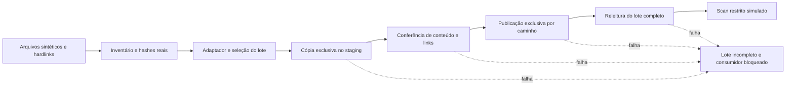

# Planejar a migração por lotes

O requisito é servir o conteúdo já validado no HD de 18 TB e acrescentar o
restante ao longo dos dias, preservando todos os discos de origem. O projeto de
mídia prepara o cálculo dos lotes, a interpretação de inventários declarados e
um ensaio com arquivos sintéticos. A ferramenta de ensaio não migra o acervo.

## Estado e fronteira operacional

Em 14/11/2026, uma nova inspeção SSH observou o verificador histórico ativo,
avançando de 1.701 para 1.705 dos 6.029 grupos da classe saudável. O relatório
ainda indicava uma pendência de reparo e prova global incompleta. Contar grupos
não mede percentual de bytes, integridade global ou tempo restante.

Jellyfin e telemetria responderam HTTP 200; o controlador permaneceu com 503
no endpoint de readiness. Nenhum processo foi parado, nenhuma manutenção foi
removida e nenhum segundo pipeline foi iniciado. Esses checks não demonstram
reprodução real ou capacidade de migração em paralelo.

O corte continua aguardando aviso explícito do proprietário. O pipeline antigo
exige corte integral e uma etapa de limpeza de origens; não deve ser reaproveitado
para este requisito. A manutenção do controlador não impede, sozinha, scans
internos de Jellyfin/Arr que possam reagir à ausência de arquivos.

## API de planejamento

Módulo: `homeserver_control.domain.migration_batches`. A API é pura: não lê
filesystem, não acessa APIs e não altera banco, claims, fila, mounts ou dados.
Seu uso é programático, por testes ou por um futuro adaptador revisado.

| Tipo/função | Papel |
|---|---|
| `MigrationGeneration(generation_id, source_id, destination_id)` | Contexto imutável do snapshot; IDs lógicos, sem nomes instáveis de device |
| `MigrationGroup(group_id, paths, logical_bytes, content_sha256, dependency_ids=())` | Um inode físico com todos os paths e dependências de outros grupos |
| `DeclaredReceipt(generation_id, source_id, destination_id, group_id, manifest_digest, phase)` | Referência declarada a uma evidência de fase; não é uma prova autenticada pelo módulo |
| `manifest_digest(group)` | Digest canônico do manifesto para impedir reaproveitar referências após mudança de grupo |
| `plan_batch(generation, groups, selected_paths, receipts=())` | Expansão completa dos grupos/dependências e avaliação das referências declaradas |

Todos os caminhos são relativos à raiz lógica da migração. O adaptador precisa
comprovar a identidade real dos dispositivos, mapear todas as origens e destinos,
estabilizar a geração e descobrir os links físicos. Dois inodes com conteúdo
igual continuam sendo dois grupos: o hash não autoriza deduplicação física.

O digest liga as referências aos campos fornecidos. Não prova que o inventário
está completo ou atual, que a hash foi calculada, que o recibo tem origem confiável
ou que o filesystem corresponde aos paths. O futuro adaptador deve verificar
essas propriedades antes de usar o plano, inclusive links não informados.

## Exemplo sintético

```python
from homeserver_control.domain.migration_batches import (
    MigrationGeneration,
    MigrationGroup,
    plan_batch,
)

generation = MigrationGeneration("generation-1", "source-a", "target-a")
group = MigrationGroup(
    group_id="group-1",
    paths=("library/example.mkv", "payload/example.mkv"),
    logical_bytes=1024,
    content_sha256="a" * 64,
)
plan = plan_batch(generation, (group,), ("library/example.mkv",))
assert plan.selected_paths == ("library/example.mkv", "payload/example.mkv")
assert plan.total_logical_bytes == 1024
assert plan.execution_allowed is False
```

O hash e os bytes acima são fictícios. Selecionar um membro expande todo o grupo
e suas dependências. `total_logical_bytes` conta cada grupo uma vez; não reserva
espaço nem contabiliza sparse allocation, metadados, staging já ocupado, margem,
espaço efetivo ou compromissos de outros consumidores.

## Interpretar o resultado

`blocked_reasons` informa inconsistências que impedem um lote positivo. Campos
malformados são rejeitados. Colisões entre grupos bloqueiam mesmo com hashes
iguais, assim como conflitos entre um arquivo e um descendente desse path.
Dependências ausentes ou cíclicas não devem gerar publicação parcial.

`evidence_states` separa referências às fases `staging_verified`,
`publication_verified` e `native_readback_verified`. Só uma cadeia compatível
com a geração, identidades e manifesto promove os indicadores declarados. Uma
fase final isolada ou recibo de outra geração não equivale a disponibilidade.
Esses nomes descrevem o tipo de evidência que o adaptador deverá produzir.

O módulo confere a presença das fases compatíveis; não autentica uma cadeia
temporal, não liga recibos ao predecessor e não verifica tentativas, leases ou
fencing. O adaptador deverá rejeitar evidências de tentativas incompatíveis e
renovar a geração quando houver mutação ou incerteza sobre o snapshot. Reunir
três declarações não comprova que as operações ocorreram nessa ordem.

Os quatro flags operacionais permanecem falsos em todo resultado:
`execution_allowed`, `source_cleanup_allowed`, `global_scan_allowed` e
`deletion_allowed`. Nem uma lista vazia de bloqueios nem todos os indicadores
de evidência verdadeiros liberam execução no servidor.

## Adaptador de inventário

Módulo: `homeserver_control.adapters.migration_inventory`. A entrada é um
documento já carregado em memória; o adaptador não abre arquivos ou consulta o
servidor. O formato preserva os campos do inventário existente: versão, geração,
completude, arquivos, diretórios, nós especiais e colisões declaradas. Cada
arquivo informa pool, caminho relativo, device/inode, tamanho, alocação,
mtime, permissões, UID/GID e número de links. `mode` contém somente bits de
permissão, como no inventário histórico. `incident`, quando presente, é metadado
opaco vinculado ao digest; não indica um arquivo a ser aberto.

`inspect_inventory(inventory, pool_roots=..., destination_pool=...)` recebe um
mapa explícito de pools para identidades lógicas distintas. A inspeção produz
grupos imutáveis por device/inode e um digest que vincula metadados, geração e
mapa de raízes. `source_id` identifica o conjunto declarado de origens;
`destination_pool` separa a biblioteca nativa, que participa das verificações de
colisão mas não entra na fila de cópia. Essas identidades não comprovam UUIDs,
mounts ou atualidade física.

Os campos `inventory_generation`, `source_id` e `destination_id` da inspeção
devem formar a `MigrationGeneration` fornecida ao planejamento. Outra geração
ou outro conjunto lógico de origens/destino é rejeitado.

`plan_inventory_batch(inspection, generation, selected_paths,
content_declarations, dependencies=())` liga a inspeção ao planejador. Cada
`ContentDeclaration(group_id, inventory_digest, content_sha256)` fornece a hash
de conteúdo declarada para um grupo daquela inspeção. O digest do inventário
não substitui a SHA do arquivo; o adaptador não lê conteúdo para calculá-la.
Dependências são declaradas por `GroupDependencies` entre IDs dos grupos.

O resultado traz `coverage` (`required_groups`, `declared_groups` e
`missing_group_ids`) e `plan`, o `BatchPlan` já descrito. As evidências de fase
continuam falsas, mesmo com cobertura completa de hashes declaradas.

Nesta versão, todos os grupos de origem precisam ter hashes declaradas, mesmo
quando a seleção pede um lote menor. Uma cobertura parcial bloqueia o plano e
permanece visível no relatório. Isso permite conferir colisões e aliases do
conjunto inteiro sem inventar hashes ou descartar os grupos ainda não
verificados. Planejar diretamente a partir de cobertura parcial exigirá uma
extensão posterior desse contrato.

O importador não autentica recibos históricos e não transforma declarações em
evidência de staging, publicação ou leitura nativa. Nomes relativos e razões de
bloqueio podem revelar o conteúdo do acervo se o chamador usar dados reais;
esses relatórios devem permanecer privados e fora do Git.

## Ensaio de publicação

Em Linux/WSL, a partir da raiz do repositório e com o ambiente Python 3.12
preparado por `uv sync --frozen`:

```bash
.venv/bin/python scripts/rehearse-media-batch.py
.venv/bin/python scripts/rehearse-media-batch.py --scenario interruption
.venv/bin/python scripts/rehearse-media-batch.py --help
```

O primeiro comando executa o cenário de sucesso. O segundo injeta uma
interrupção e deve terminar com código 1 e lote incompleto no JSON; código 0
indica conclusão somente da fixture. Opções inválidas retornam 2. A CLI não
aceita `--source`, `--destination`, `--apply` ou `--resume`. Ela não precisa de
credenciais, Docker, rede ou privilégios de root.

O ensaio percorre este fluxo apenas em seu diretório temporário:



Publicar vários caminhos é uma operação multietapa. Uma interrupção pode deixar
parte deles publicada na fixture; isso nunca conta como conclusão. O staging e
os caminhos parciais são conservados até o relatório do ensaio, e o diretório
temporário inteiro é removido ao terminar. Não há retomada de uma execução
anterior ou aceitação de journal externo.

Fontes sintéticas e staging usam inodes diferentes. Dois arquivos de origem com
bytes iguais continuam sendo grupos distintos, e a ferramenta verifica hashes
e topologia dos aliases. Conteúdo não selecionado não deve aparecer no destino.
O relatório diferencia essas operações reais de filesystem da contenção
**simulada** de Jellyfin, Sonarr e Radarr. Sucesso na fixture mantém
`production_ready=false` e todas as permissões operacionais falsas.

## Dependências para implementar o executor

1. Reconciliar o verificador ativo, pendências de reparo, provas e publicação
   anterior. Não iniciar outro escritor enquanto o pipeline mantém seus locks.
2. Produzir inventário fresco e privado por inode, links, conteúdo, dependências
   e colisões, diferenciando biblioteca nativa e staging. Medir capacidade real.
3. Demonstrar contenção dos scans e efeitos de ausência no Jellyfin/Arr, além dos
   guards do controlador. Ausência durante migração nunca autoriza exclusão.
4. Implementar journal, lock/fencing, quiescência por lote, cópia sem sobrescrita,
   prova de conteúdo/topologia e leitura nativa antes da publicação/retomada.
5. Ensaiar interrupção, retorno do USB, geração alterada e rollback em fixtures;
   revisar o conjunto de comandos e o estado real antes da janela autorizada.

O ensaio local de publicação acrescenta evidência sobre cópia, hashes,
hardlinks e bloqueios de falhas em arquivos pequenos. A contenção de consumidores
é simulada; não comprova que APIs ou scans de Jellyfin/Arr respeitem esses
bloqueios no servidor. Também não exercita perda de energia ou reconexão USB,
capacidade real, sparse, ACLs/xattrs, locks entre processos ou retomada após
crash. Esses itens continuam necessários para o executor operacional.

A [plataforma](https://github.com/reisguilherme/homelab-platform/blob/refactor/docs/architecture/README.md)
mantém a autoridade sobre recursos físicos, mounts e exports. Este consumidor
mantém o planejamento lógico e os efeitos sobre a aplicação. Consulte o
[plano operacional](../superpowers/plans/2026-11-14-homelab-refactor-migration.md)
e o [registro de preparação](../architecture/homelab-2026/implementation-status.md).

## Verificação do planejador puro

Python 3.12.3/WSL: 213 testes passaram, incluindo 69 casos do planejador e
regressões de singleton, consumidores, recuperação USB, admissão e exclusão
coordenada. Um caso foi pulado por exigir root real para fixture UID1000; nenhum
teste usou o acervo. Ruff e a revisão independente passaram. Essa rodada não
representa execução da suíte completa nem validação física do servidor.

## Verificação do adaptador e do ensaio

Python 3.12/WSL: 126 testes passaram, sem skips: 41 do inventário, 16 do ensaio
e os 69 do planejador puro. Ruff passou nos cinco arquivos novos. Essa rodada
tem sobreposição com a verificação anterior; não somar as contagens.

A CLI também foi executada diretamente. O caso de sucesso publicou três grupos
e quatro caminhos na fixture e manteve as fontes. O caso `containment_loss`
retornou 1, conservou um caminho parcial até encerrar o ensaio e bloqueou o scan
simulado. Os testes cobrem ainda interrupção, colisão, corrupção de mesmo tamanho
no staging e após publicação, mudança de origem, hardlink não contabilizado e
symlink. Nenhum desses resultados é uma verificação do acervo ou dos serviços
reais; não houve nova conexão SSH ou implantação nesta etapa.
