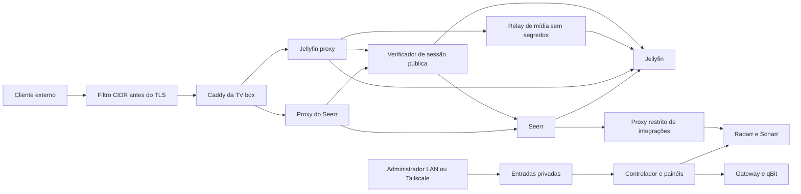

# Segurança do acesso público do HomeServer — desenho proposto

**Estado:** proposta para revisão, sem autorização implícita para implantação.
**Data de referência:** 15/10/2026, America/Sao_Paulo.
**Plano:** [tarefas de implementação](../plans/2026-10-15-public-access-security.md).

## 1. Objetivo e evidência

Reduzir a superfície exposta de Jellyfin e Seerr e conter o alcance de uma falha nesses aplicativos. Preservar reprodução, pedidos, administração privada, downloads, armazenamento e recuperação dos discos. O resultado deve ser comprovado por testes de rede e aplicação, inclusive depois de reinícios.

A auditoria privada está em `.runtime/security-audit-20261015/report.html`. Ela registrou 84 verificações de borda com resultado esperado e nove endpoints administrativos recusando acesso anônimo. Isso comprova controles específicos; não comprova isolamento após comprometimento.

Achados que orientam o trabalho:

| ID | Evidência da auditoria | Resultado exigido |
| --- | --- | --- |
| S01 | Jellyfin 10.10.7 e Jellyseerr 2.7.3, com avisos de segurança aplicáveis | Versões corrigidas, integrações compatíveis e migração recuperável |
| S02 | Caddy alcança SSH e painéis internos; Seerr alcança controlador e host | Conexões novas negadas fora de uma matriz explícita |
| S03 | Relay de navegação compartilha processo e segredos do controlador | Relay separado, sem credenciais administrativas, banco ou mídia |
| S04 | Dezesseis contas Jellyfin sem limite de tentativas; administrador remoto | Política persistente, recuperação privada e testes com sessões existentes |
| S05 | Seerr sem CSRF adicional e sem confiança configurada no proxy | HTTPS privado e público, cookies corretos e cadeia de proxies restrita |
| S06 | Erro Nginx reproduzido registrando token fictício na query | Nenhum segredo em logs de requisição, mantendo diagnóstico sanitizado |
| S07 | SSH por senha/root na TV box; Caddy com capacidades excessivas | Acesso administrativo por chave validada e menor privilégio |
| S08 | Containers públicos sem limites explícitos; ampla leitura de `.env` | Ambientes por papel, limites medidos e montagens mínimas |
| S09 | IPv6 global, firewall HomeServer e ACL Tailscale incompletamente verificados | Política IPv4/IPv6 efetiva, persistente e testada |
| S10 | TV box na LAN e Jellyfin com mídia gravável | Riscos explicitamente separados das correções de aplicação; evolução de isolamento definida |

Os valores de IP, credenciais, usuários, configurações completas e bancos permanecem privados. Os documentos versionáveis usam nomes de papéis. A auditoria não demonstrou invasão nem executou exploração, força bruta ou negação de serviço.

## 2. Abordagem escolhida e alternativas

**Base recomendada:** endurecer a instalação existente primeiro, sem comprar VPS ou mudar o domínio. A borda continua na TV box, expondo somente os dois aplicativos pela porta pública já configurada. O Tailscale permanece como caminho privado. Atualizações e redução de privilégios trazem benefício mesmo antes de alterar a rede física.

| Opção | Benefício | Limite / dependência |
| --- | --- | --- |
| TV box atual, aplicações e firewall endurecidos | Menor mudança operacional; mantém equipamentos e URLs | Root na TV box ainda pode contornar o firewall dela e alcançar a LAN |
| TV box e servidor em segmentos próprios, com ACL no equipamento de rede | Barreira externa aos hosts; opção preferida para conter movimento lateral | Precisa comprovar VLAN/segmentação real e capacidade do roteador/switch; configuração do roteador é manual pelo proprietário |
| VPS externa e túnel limitado aos aplicativos | Remove a entrada pública residencial quando os encaminhamentos forem retirados | Custo, banda e dependência externa; túnel amplo recriaria o risco. Não isola um HomeServer comprometido da LAN por si só |

Uma opção chamada “DMZ host” no roteador costuma encaminhar portas; não será tratada como segmento isolado. Não haverá compra, contratação ou troca automática de topologia neste plano.

## 3. Fronteiras de confiança

O diagrama representa o alvo lógico, não uma rede já implantada. O proxy de integrações é necessário para restringir operações HTTP: a chave nativa dos *arr não diferencia “consultar/adicionar” de todas as demais operações. O controlador continua sendo componente privilegiado e privado.

### Matriz mínima

| Origem | Permissão | Negativa obrigatória |
| --- | --- | --- |
| Internet autorizada | HTTPS público de Jellyfin/Seerr, com autenticação nativa | SSH, controlador, status, qBit e *arr |
| Internet não autorizada | Nenhuma entrada dos aplicativos | Bloqueio de rede e do proxy, mesmo com headers forjados |
| Caddy da TV box | Dois upstreams fixos; DNS e HTTPS necessários a certificados/Dynu | Roteador, SSH, control-api, qBit, *arr, outras máquinas da LAN/tailnet |
| Relay de mídia | Jellyfin, usando exclusivamente credencial do cliente | `.env`, API administrativa global, SQLite do controlador, mídia e demais serviços |
| Verificador de sessão pública | Endpoints internos fixos de identidade Jellyfin/Seerr, com credencial do cliente | Tokens próprios, bancos, mídia, controlador, *arr e SSH |
| Jellyfin | Metadados/legendas necessários e respostas a clientes | Novas conexões a administração, host, roteador e máquinas privadas |
| Seerr | Jellyfin; proxy de integração; metadados/imagens necessários | Acesso direto a *arr, qBit, controlador, host e LAN |
| Proxy de integração | Métodos/rotas comprovadamente usados pelo Seerr em *arr | Exclusão de mídia, configuração de clientes, comandos genéricos e upstream escolhido pelo cliente |
| Administrador privado | Acessos atuais por LAN/Tailscale conforme identidade autorizada | Nenhuma liberação genérica de toda a tailnet como administrador |
| Worker/gateway | Dependências atuais de aquisição, importação e exclusão coordenada | Mudanças de política não relacionadas à segurança |

Negativas incluem IPv4 privado, gateways Docker, loopback de outros destinos, link-local, metadata endpoints, tailnet, IPv6 ULA e **prefixos globais IPv6 da rede local**. DNS público que resolva para destino privado não pode contornar a política. Exceções positivas são aplicadas antes das negativas e limitadas a destino, porta e papel.

O backend de firewall do Docker será descoberto e preservado. `DOCKER-USER` aplica-se ao backend iptables; nftables nativo exige tabela própria. Não editar tabelas geradas pelo Docker nem confiar somente no UFW/INPUT para portas publicadas. [Docker: filtragem](https://docs.docker.com/engine/network/packet-filtering-firewalls/), [Docker: nftables](https://docs.docker.com/engine/network/firewall-nftables/).

## 4. Contratos de segurança e compatibilidade

### Aplicativos

Alvos candidatos verificados: Jellyfin **12.2**, Seerr **3.5.0**. Resolver digest e arquitetura oficiais no início da implementação; revalidar avisos nessa data. Não usar `latest` nem inventar digest.

O salto Jellyfin parte de 10.10.7, exige adaptação da autenticação própria, cópia consistente de configuração/dados, avaliação de plugins e scan após migração. A reversão restaura dados anteriores e imagem anterior juntos. [Notas de migração](https://jellyfin.org/posts/jellyfin-release-12.0/), [release 12.2](https://github.com/jellyfin/jellyfin/releases/tag/v12.2).

Seerr migra o estado existente no primeiro início da imagem oficial. Preservar o nome interno `seerr`, `/app/config`, contas, pedidos e integrações; usar `init: true` e validar usuário efetivo. [Migração oficial](https://docs.seerr.dev/migration-guide/), [release 3.5.0](https://github.com/seerr-team/seerr/releases/tag/v3.5.0).

### Identidade, HTTPS e administração

- CIDR restringe redes de origem; não identifica pessoas ou dispositivos. Manter autenticação individual mesmo para um /32 permitido.
- Administrador usa conta separada da conta de reprodução. Objetivo: administração somente pela entrada privada, incluindo sessões já emitidas. Uma mudança de flag no login não basta para aprovar esse requisito.
- A entrada pública acrescenta uma verificação de sessão usando `/Users/Me` do Jellyfin e recusa identidade administrativa ou chave sem identidade de usuário. Essa verificação usa o token do cliente, não uma chave administrativa. Exceções anônimas limitam-se a rotas públicas de login/descoberta e assets comprovados; a autorização nativa continua obrigatória no aplicativo. A política remota nativa não é global para todas as rotas, conforme o [registro de políticas do Jellyfin](https://raw.githubusercontent.com/jellyfin/jellyfin/v12.2/Jellyfin.Server/Extensions/ApiServiceCollectionExtensions.cs).
- Seerr recebe proteção equivalente com sua sessão nativa e permissões próprias, incluindo cookie administrativo já emitido. A autenticação Seerr→Jellyfin é interna e não prova que o usuário acessou a entrada privada. Rotas administrativas de API, além da página de configurações, devem ser recusadas publicamente.
- Proposta de limite: cinco falhas consecutivas por conta Jellyfin. Não presumir desbloqueio temporizado; comprovar semântica e procedimento de recuperação na versão alvo antes de aplicar às contas reais.
- A reconciliação deve manter a política após reinícios, preservar senhas/IDs e não promover outros usuários.
- A ativação de CSRF do Seerr depende de HTTPS privado funcional. Os cookies CSRF de produção são `Secure`; preservar HTTP funcional para operações autenticadas seria incompatível. A confiança ampla do campo `trustProxy` exige entrada direta fechada e sanitização em todos os proxies. [Código oficial Seerr 3.5](https://raw.githubusercontent.com/seerr-team/seerr/v3.5.0/server/index.ts).
- Preferir Tailscale Serve com HTTPS para acesso remoto privado ao Seerr, sem Funnel. Para LAN, validar o domínio HTTPS por hairpin; se não funcionar, preparar resolução local do mesmo nome **e URL privada na porta 443**, atendida pelo listener LAN e por política privada explícita. A URL pública continua na 54443: DNS não traduz portas. Não alterar o roteador automaticamente. A ativação de CSRF espera esse teste. [Tailscale Serve](https://tailscale.com/docs/features/tailscale-serve).
- Entradas públicas recusam exclusão coordenada de mídia. A mesma função continua disponível ao proprietário pela entrada privada, com autorização já existente.

### Processo, segredos e logs

- `.env` permanece a fonte privada de parâmetros e credenciais, sem arquivos `*_FILE`.
- Processos contínuos recebem somente as variáveis necessárias ao papel. Campo novo de credencial não é distribuído automaticamente.
- Relay e proxies públicos não recebem chaves administrativas nem montagem do projeto. Telemetria e métricas recebem dados sanitizados, sem credenciais.
- Caddy recebe somente a capacidade necessária para bind, sem `CAP_NET_ADMIN`, e diretórios de escrita delimitados. A unit existente do fornecedor pode receber drop-in; não criar units próprias.
- Logs de requisição excluem query, cookies, autorização, corpos, URLs completas e headers arbitrários. Registrar tempo, origem validada, classe de rota, status e duração. Erros nativos que não possam ser sanitizados não serão persistidos.
- Limites de memória/processos dependem de medição de playback/transcode e da capacidade efetiva. Rootfs somente leitura não torna bind mounts RW somente leitura.

## 5. Restrições globais

- Desenvolvimento e testes de referência: Linux/WSL2, Python 3.12, `uv sync --frozen`.
- Nenhuma formatação, alteração de montagem/fstab, ativação RTX ou mudança no serviço Lenovo.
- Nenhuma abertura de porta no roteador pelo agente; qBit administrativo nativo permanece sem exposição pública.
- Nenhuma exclusão de mídia, alteração da fila ou download como efeito colateral dos testes.
- Jellyfin mantém escrita para edições e legendas nesta etapa; o risco de escrita de mídia permanece explícito.
- Preservar `compose.yaml`, `compose.storage.yaml`, `compose.storage.extra.yaml` e `compose.storage.fourth.yaml` na avaliação da configuração efetiva.
- Nenhum CI/CD, gerenciador de backups, release própria ou unit de host nova.
- Testes usam fixtures temporárias; ensaios de migração usam cópias privadas isoladas, nunca bancos ativos compartilhados.
- `.env`, credenciais, bancos, inventário bruto e endereços privados reais ficam fora do Git.
- Mudanças existentes no workspace não serão revertidas, limpas ou incluídas indiscriminadamente em commits.

## 6. Critérios de conclusão e limites

**Entrega A — aplicações e hosts endurecidos:** correções de versões, contenção entre processos, firewall, autenticação, logs e compatibilidade passam pelos testes do plano. O relatório identifica evidências reais e o que ficou sem teste. Falha de um controle crítico mantém a publicação em manutenção, com administração privada disponível durante a execução aprovada.

**Entrega B — contenção de um host comprometido:** exige segmentação aplicada fora da TV box e, para proteger os demais dispositivos de um HomeServer comprometido, fora do próprio HomeServer. Esta etapa depende de infraestrutura e intervenção manual do proprietário. Não declarar “rede isolada” ao concluir somente a Entrega A.

A segmentação cobre Ethernet, Wi-Fi, IPv6 e Tailscale. Uma segunda interface na LAN pessoal ou grants amplos do nó de borda contornariam a barreira. A identidade da borda no overlay só pode alcançar os upstreams previstos; identidades administrativas são distintas.

A mídia RW continua vulnerável a escrita por um processo Jellyfin comprometido. A evolução para mídia somente leitura requer transferir edições/legendas para um escritor privado e validar esse fluxo; não está autorizada como simples mudança de mount neste trabalho. Limites de aplicação não impedem saturação do link residencial. Nenhuma etapa promete risco zero.
